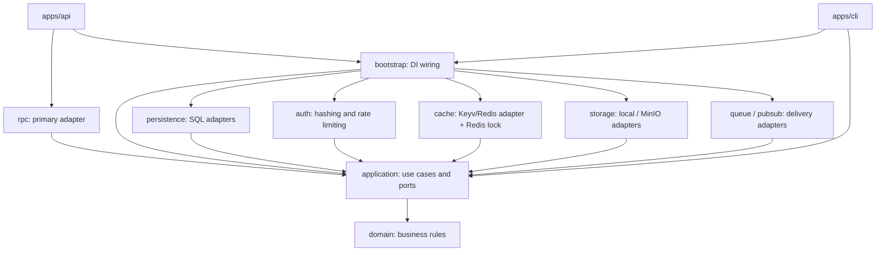
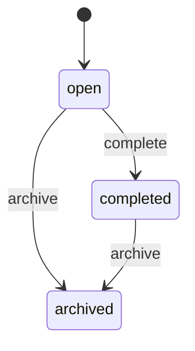
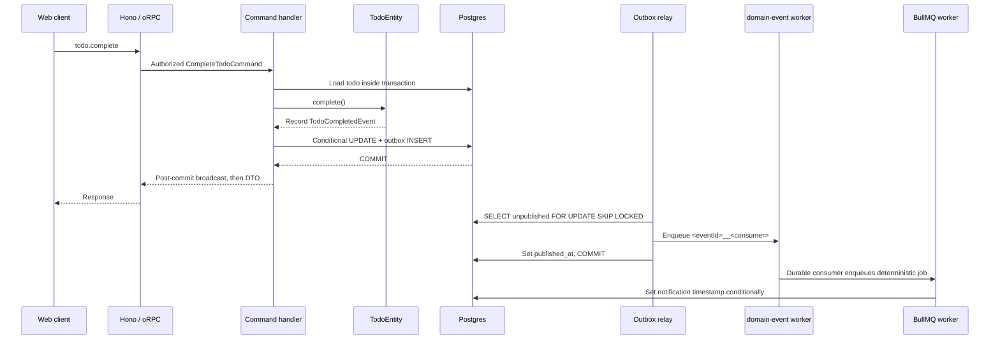

# hexstack

A runnable TypeScript monorepo for applications with business rules, explicit use cases, and reliable background work.
It combines **Domain-Driven Design**, **Hexagonal Architecture (ports and adapters)**, **CQRS**, a transactional outbox,
cookie-based authentication with RBAC, Redis caching, and local/S3-compatible object storage.

The example is deliberately small: create, complete, and archive a `todo`. Reusable `user` and `session` models show
how authentication fits into the same architecture. There is no product-specific logic.

This guide's structure and approach are inspired by [Sairyss/domain-driven-hexagon](https://github.com/Sairyss/domain-driven-hexagon).
The explanations and code links below describe **this repository**, not its NestJS/Slonik implementation.
Authentication guidance also draws on [Pilcrow's Auth Book](https://auth.pilcrowonpaper.com/).

> Patterns are tools, not requirements. Keep the boundaries that help your application; simplify or remove the
> machinery that does not. A small CRUD application may not need aggregates, command buses, specifications, or an outbox.

## Contents

- [Getting started](#getting-started)
- [Architecture](#architecture)
  - [Benefits and costs](#benefits-and-costs)
  - [Dependency direction](#dependency-direction)
  - [Deliberate choices](#deliberate-choices)
- [Modules and project structure](#modules-and-project-structure)
- [Application core](#application-core)
- [Application layer](#application-layer)
  - [Use cases](#use-cases)
  - [Commands and queries](#commands-and-queries)
  - [Ports](#ports)
  - [Transactions and concurrency](#transactions-and-concurrency)
- [Domain layer](#domain-layer)
  - [Entities and aggregates](#entities-and-aggregates)
  - [Value objects and invariants](#value-objects-and-invariants)
  - [Validation and guarding](#validation-and-guarding)
  - [Specifications](#specifications)
  - [Domain policies and services](#domain-policies-and-services)
  - [Errors](#errors)
- [Events and reliable delivery](#events-and-reliable-delivery)
  - [In-process and durable handlers](#in-process-and-durable-handlers)
  - [Example flow: complete a todo](#example-flow-complete-a-todo)
- [Interface adapters](#interface-adapters)
  - [HTTP and RPC](#http-and-rpc)
  - [REST example: list todos](#rest-example-list-todos)
  - [DTOs and mappers](#dtos-and-mappers)
  - [Web client](#web-client)
- [Infrastructure layer](#infrastructure-layer)
  - [Persistence](#persistence)
  - [Redis caching](#redis-caching)
  - [Object storage](#object-storage)
  - [Queues and scheduling](#queues-and-scheduling)
  - [Composition root](#composition-root)
- [Authentication and authorization](#authentication-and-authorization)
  - [Accounts and passwords](#accounts-and-passwords)
  - [Session lifecycle](#session-lifecycle)
  - [Role-based access control](#role-based-access-control)
  - [Rate limiting and security trade-offs](#rate-limiting-and-security-trade-offs)
  - [Deployment rules](#deployment-rules)
- [Container images and releases](#container-images-and-releases)
- [Testing](#testing)
- [Add a bounded context](#add-a-bounded-context)
- [Rename for a new project](#rename-for-a-new-project)
- [Recommendations and limitations](#recommendations-and-limitations)
- [Further reading](#further-reading)

## Getting started

Requires **Node ≥24.7** (`node:crypto.argon2`), **pnpm 12**, and Docker for local Postgres and Redis.
Tool versions are recorded in [mise.toml](mise.toml) and [package.json](package.json).

With Docker running, start the default local setup from the repository root:

```sh
pnpm install
cp .env.example .env       # first setup only; do not overwrite existing local configuration
pnpm dev
```

The example env already matches [compose.yaml](deployment/docker/compose.yaml): Postgres on **6889**, Redis on **6888**.
No port edits are needed for a fresh setup, provided those ports are available. If you already have a `.env` from an
older setup, check `POSTGRES_URL` and `REDIS_URL` against these mappings instead of replacing the whole file.
If you change a Compose host port or use existing services, update its URL in `.env` to match.

`pnpm dev` starts local Postgres and Redis, waits for their health checks (up to 120 seconds), applies pending migrations,
then runs API and web development servers together through Turbo. If infrastructure startup or migration fails,
neither development server starts. These are local placeholder credentials, not production infrastructure.

- API: http://localhost:3001 (health at `/health`, REST example at `GET /todos`, oRPC at `/rpc/*`).
- Web: http://localhost:3000.

Verify the API is ready:

```sh
curl --fail http://localhost:3001/health  # {"status":"ok"}
```

The default storage driver is `local`, so MinIO is not required for this startup path. To use MinIO, configure
`STORAGE_DRIVER=minio` and run `pnpm infra:storage` before `pnpm dev`; see [Object storage](#object-storage).
`pnpm dev` does not automatically start or initialize MinIO.

Press `Ctrl+C` to stop both development servers. Infrastructure stays running; use `pnpm infra:down` to stop it.
To run only one app against ready infrastructure and an already migrated database, use `pnpm dev:api` or `pnpm dev:web`.

Create an account in the web UI. New accounts are **members**; they can create, read, and complete todos.
Provision the first admin from a trusted operator shell, then refresh the UI:

```sh
pnpm cli user role you@example.com admin
```

There are no seed passwords, automatic first-user promotion, or public admin-bootstrap endpoints.
The role command uses the configured Postgres and Redis.

| Command                                       | Purpose                                                                                 |
| --------------------------------------------- | --------------------------------------------------------------------------------------- |
| `pnpm dev`                                    | Start and wait for infrastructure, migrate, then run API and web together               |
| `pnpm dev:api` / `pnpm dev:web`               | Start one app against existing infrastructure                                           |
| `pnpm infra:up`                               | Start local Postgres and Redis and wait for health checks                               |
| `pnpm build`                                  | Bundle API and CLI with tsup; build the web app with Next.js                            |
| `pnpm test`                                   | Run Vitest; persistence tests use real migrations on PGlite, without Docker             |
| `pnpm check-types`                            | Type-check workspace packages and apps                                                  |
| `pnpm lint` / `pnpm format:check`             | Check code with oxlint / oxfmt                                                          |
| `pnpm format`                                 | Format TypeScript, JavaScript, CSS, and JSON                                            |
| `pnpm db:generate --name <change>`            | Generate a migration from the Drizzle schema                                            |
| `pnpm db:migrate`                             | Apply pending migrations under a Postgres advisory lock                                 |
| `pnpm db:studio`                              | Open Drizzle Studio against the configured database                                     |
| `pnpm infra:storage`                          | Start MinIO, wait for readiness, and create a private bucket (API :9000, console :9001) |
| `pnpm cli storage <put/get/head/delete/sign>` | Exercise the object-storage port without a public file API                              |
| `pnpm infra:down`                             | Stop the local infrastructure                                                           |

Local configuration lives in [.env.example](.env.example). Do not commit real credentials or copy its
plain-HTTP cookie setting into production; see [Deployment rules](#deployment-rules).

<details>
<summary>Calling the API with curl</summary>

First create an account in the UI. In a Bash shell, sign in without putting the password in shell history
or curl's process arguments:

```sh
read -rs -p 'Local password: ' PASSWORD; echo
export PASSWORD
umask 077                 # the cookie jar contains a session secret
node -e 'console.log(JSON.stringify({json:{email:process.argv[1],password:process.env.PASSWORD}}))' you@example.com |
  curl -c /tmp/app-cookies -X POST localhost:3001/rpc/auth/signIn -H 'content-type: application/json' --data-binary @-
unset PASSWORD

curl -b /tmp/app-cookies -X POST localhost:3001/rpc/todo/create \
  -H 'content-type: application/json' -d '{"json":{"title":"hello"}}'
curl -b /tmp/app-cookies -X POST localhost:3001/rpc/todo/complete \
  -H 'content-type: application/json' -d '{"json":{"todoId":"<id>"}}'
curl -b /tmp/app-cookies localhost:3001/rpc/todo/list
# Same use case over REST: no oRPC envelope, query string instead of a JSON body.
curl -b /tmp/app-cookies 'localhost:3001/todos?status=open&limit=10'
# completionNotifiedAt is set asynchronously by the worker while the todo is still completed.

# Archive requires an admin role:
curl -b /tmp/app-cookies -X POST localhost:3001/rpc/todo/archive \
  -H 'content-type: application/json' -d '{"json":{"todoId":"<id>"}}'
rm /tmp/app-cookies
```

The `{ "json": ... }` envelope is oRPC's wire format, not a hand-written REST contract.
`GET /todos` is the REST exception; see [REST example: list todos](#rest-example-list-todos).
TypeScript consumers should normally use the [typed client](packages/rpc/src/client.ts).

</details>

## Architecture

The goal is to keep **business decisions** separate from **how the application is accessed** and **how data or messages are stored**.

- **DDD:** meaningful types, entities, state transitions, and events express the domain's language.
- **Hexagonal Architecture:** application ports describe required capabilities; infrastructure adapters implement them.
- **CQRS:** named commands change state; named queries retrieve it. Both currently use the same Postgres database.
- **Reliable delivery:** a transactional outbox bridges committed database writes and asynchronous BullMQ work.
- **Explicit security boundaries:** domain objects guard their values; RPC procedures enforce authentication and permissions.

This is a modular monolith, not a microservices platform. CQRS does not imply separate databases, and domain events
do not imply event sourcing. Current state is stored in relational tables, not reconstructed from an event log.

### Benefits and costs

| Benefits                                                       | Costs and limits                                                                        |
| -------------------------------------------------------------- | --------------------------------------------------------------------------------------- |
| Domain behavior can be tested without HTTP, Postgres, or Redis | More files and mapping than a direct CRUD endpoint                                      |
| Use cases can be invoked from multiple entry points            | DI tokens, handler registration, and transaction boundaries need care                   |
| Infrastructure dependencies are visible through ports          | Replacing Postgres or BullMQ still requires implementing their guarantees               |
| Outbox consumers can retry after a process failure             | Delivery is at-least-once; consumers must be idempotent; Redis must be durable          |
| Permission checks are centralized at the RPC boundary          | Internal command/query calls are trusted; new entry points need their own authorization |

Use this structure when the rules and workflows justify the overhead. Do not add a port, service, or value object
just to fill an architectural diagram.

### Dependency direction

Arrows below mean **imports/dependencies**, not execution order. Supporting libraries such as `core`, `cqrs`, `di`,
and `zod` are omitted for clarity.



An application handler depends on `ITodoRepository`, not `TodoRepository`. At runtime the SQL adapter executes
that contract, but its source dependency points **toward** the application port, not the other way around.

### Deliberate choices

These are local trade-offs, not universal DDD rules:

| Choice                                                                  | Reason / consequence                                                                                                                                                  |
| ----------------------------------------------------------------------- | --------------------------------------------------------------------------------------------------------------------------------------------------------------------- |
| Layer packages, with context folders inside them                        | Keep `packages/application` together instead of creating separate ports/usecases packages; related `todo` files span a few explicit layers                            |
| Repository/specification-based reads                                    | The example query handlers use the same domain/repository vocabulary as commands; no separate SQL projection layer yet                                                |
| Shared Zod schemas for inputs and value-object guards where appropriate | Less validation duplication, at the cost of a deliberate validation-library dependency in the core                                                                    |
| One plain-object mapper in application                                  | `toEntity`, `toPersistence`, and `toResponse` stay together, without DI; stored record shapes are consequently visible to application code                            |
| Typed errors, ordinary throws                                           | Business failures extend `DomainError` with a literal `_tag` and typed fields; HTTP/RPC translate them centrally and BullMQ reads `retryable` (see [Errors](#errors)) |
| Post-commit in-process events                                           | Logging/broadcast failures cannot roll back successful writes; required side effects use the outbox instead                                                           |

## Modules and project structure

A module should reflect a domain concept, not just a technical category. Here `todo` is the worked business example;
`user`, `session`, and `rbac` form the reusable authentication/authorization area. A folder is not automatically an
independent bounded context: user and session intentionally collaborate.

```text
apps/
  api/                  Hono server and HTTP middleware
    drizzle/postgres/   generated SQL migrations and snapshots
  cli/                  clipanion: migrations, operator role assignment, storage commands
  web/                  Next.js App Router, TanStack Query, Tailwind v4
packages/
  domain/               todo, user, session, rbac: entities, value objects, specs, events
  application/          use cases, repository ports, DTOs, mappers, transaction/outbox/job contracts
  persistence/          Drizzle schema, Kysely repositories, transaction manager, migrator
  auth/                 Argon2id hasher, Redis rate limiter, cookie helpers
  cache/                Keyv CachePort adapter, versioned namespaces, Redis LockPort
  storage/              ObjectStoragePort adapters: local files or MinIO/S3-compatible storage
  rpc/                  oRPC routes, protected procedures, error mapping, typed client
  bootstrap/            registerDI(): infrastructure bindings and handler registration
  core/                 entity/event/specification primitives, value objects, exceptions, ids
  cqrs/                 command, query and in-process event buses
  context/              AsyncLocalStorage: request id, client address, principal
  di/  zod/  logger/     small shared-library wrappers
  env/                  validated runtime environment
  redis/                Redis client/configuration
  queue/                BullMQ JobDispatcher
  pubsub/               outbox relay and durable handler dispatch
  typescript-config/    shared TypeScript configuration
```

Start a feature by following its name across the layers:

- [Domain: todo](packages/domain/src/todo)
- [Application: todo](packages/application/src/todo)
- [SQL adapter: todo](packages/persistence/src/todo)
- [RPC routes: todo](packages/rpc/src/routes/todo.ts)
- [Web UI: todos](apps/web/app/todos.tsx)

Keep new use cases small and named after an action. Prefer a context's exported contracts over reaching into another
context's internals. Do not introduce service-to-service command chains or a generic base repository when a focused
function or port is enough.

Workspace packages export TypeScript source. API/CLI builds bundle it with tsup; Next.js transpiles the web-facing
workspace dependency. The browser uses router **types**, not server implementations; no code generation is required.

## Application core

The core consists of two kinds of responsibility:

| Layer           | Owns                                                                                            | Does not own                                                 |
| --------------- | ----------------------------------------------------------------------------------------------- | ------------------------------------------------------------ |
| **Domain**      | Meaningful values, allowed transitions, entity behavior, facts that happened                    | HTTP routes, cookies, SQL queries, queue clients             |
| **Application** | Use-case sequencing, ports, transaction boundaries, response mapping, side-effect orchestration | Hono/Next handlers or concrete Postgres/Redis/BullMQ clients |

The core is not literally dependency-free. It uses shared primitives, CQRS/DI decorators, and Zod; application session
token generation also uses Node's crypto API. Domain factories generate ids/timestamps, with explicit dates accepted
where needed for tests. Those are pragmatic dependencies, not a claim of completely pure or universally portable code.

Keep transport frameworks and external-resource clients outside the core. Add a new abstraction only when it gives
a useful boundary, not simply to hide every library import.

## Application layer

### Use cases

A command/query handler is an application service: it coordinates a task without taking ownership of the entity's rules.
A typical write:

1. Convert primitive input to domain types.
2. Load the aggregate through a repository port.
3. Call a domain method, such as `todo.complete()`.
4. Persist the change and any durable events in one transaction.
5. Publish best-effort events after commit and return an explicit response DTO.

The handler decides **what must happen together**; the entity decides **whether the transition is allowed**.
Avoid moving status rules into routes or turning entities into bags of public setters.

Example: [CompleteTodoCommandHandler](packages/application/src/todo/commands/complete-todo.command.ts).
For authentication, [SignUpCommandHandler](packages/application/src/auth/commands/sign-up.command.ts) hashes outside
the transaction, then inserts the user and starts its session atomically.

### Commands and queries

- A **command** expresses intent to change state: `CreateTodoCommand`, `CompleteTodoCommand`, `AssignRoleCommand`.
- A **query** asks for data: `ListTodosQuery`, `GetCurrentUserQuery`, `ListUsersQuery`.
- `CommandBus` / `QueryBus` select the registered handler. They are not message brokers or durable queues.
- Commands return DTOs when useful; the template does not enforce a strict "commands return nothing" rule.
- Business query handlers do not perform business writes. The HTTP authentication middleware may independently
  refresh/clean up a session while serving a request.

Handlers are registered in [registerDomainCqrsHandlers()](packages/application/src/register.ts).
Keep infrastructure ports registered before resolving handlers that inject them.

Examples: [todo commands](packages/application/src/todo/commands), [todo queries](packages/application/src/todo/queries),
[command/query/event buses](packages/cqrs/src).

### Ports

A port describes a capability the use case needs, without exposing the tool that provides it.
Design it around application behavior, not around an ORM's entire API.

| Port                                                                                   | Implementation                                                                                                                         |
| -------------------------------------------------------------------------------------- | -------------------------------------------------------------------------------------------------------------------------------------- |
| [ITodoRepository](packages/application/src/todo/todo.repository.port.ts)               | [Kysely TodoRepository](packages/persistence/src/todo/todo.repository.ts)                                                              |
| [IUserRepository](packages/application/src/user/user.repository.port.ts)               | [Kysely UserRepository](packages/persistence/src/user/user.repository.ts)                                                              |
| [ISessionRepository](packages/application/src/auth/session.repository.port.ts)         | [Kysely SessionRepository](packages/persistence/src/session/session.repository.ts)                                                     |
| [ApplicationTransactionPort](packages/application/src/transaction/transaction.port.ts) | [ApplicationTransactionAdapter](packages/persistence/src/transaction/application-transaction-adapter.ts)                               |
| [PasswordHasher](packages/application/src/auth/password-hasher.port.ts)                | [Argon2PasswordHasher](packages/auth/src/argon2-password-hasher.ts)                                                                    |
| [RateLimiter](packages/application/src/auth/rate-limiter.port.ts)                      | [RedisTokenBucketRateLimiter](packages/auth/src/redis-rate-limiter.ts)                                                                 |
| [JobDispatcher](packages/application/src/queue/queue.port.ts)                          | [BullMQ adapter](packages/queue/src)                                                                                                   |
| [CachePort](packages/application/src/cache/cache.port.ts)                              | [KeyvCacheAdapter](packages/cache/src/keyv-cache.adapter.ts)                                                                           |
| [LockPort](packages/application/src/lock/lock.port.ts)                                 | [RedisLockAdapter](packages/cache/src/lock.adapter.ts)                                                                                 |
| [ObjectStoragePort](packages/application/src/storage/object-storage.port.ts)           | [Local](packages/storage/src/local-object-storage.adapter.ts) / [MinIO](packages/storage/src/minio-object-storage.adapter.ts) adapters |

The same interfaces support in-memory test adapters. Mappers and simple policies do **not** need a port or DI token
when there is no external capability to abstract.

### Transactions and concurrency

[runWithDomainEvents()](packages/application/src/shared/run-with-domain-events.ts) wraps the business write and outbox
append in the same application transaction. Repositories obtain the current executor from the transaction manager,
so the todo update and outbox insert cannot commit independently.

A domain guard is necessary but not sufficient under concurrency: two requests can both load an `open` todo.
[updateIfStatus()](packages/persistence/src/todo/todo.repository.ts) uses a conditional SQL update matching the previously
read status. Only one competing transition succeeds; the loser throws `TodoModifiedConcurrentlyError`, rolling back its outbox work.

Choose concurrency controls for the invariant being protected. This is a status-based check, not a generic version-column
implementation. Unique email constraints independently protect concurrent sign-ups.

## Domain layer

### Entities and aggregates

An entity has a stable identity and behavior. An aggregate groups the state that should be changed through its root.
The small examples use one root entity with value objects, rather than a large object graph.

- [TodoEntity](packages/domain/src/todo/todo.entity.ts): owns title, status, completion metadata, and domain events.
- [UserEntity](packages/domain/src/user/user.entity.ts): owns email, password hash, role, and role-change events.
- [SessionEntity](packages/domain/src/session/session.entity.ts): owns server-side session expiry and refresh behavior;
  references the user by id, not by embedding the user aggregate.

Todo state changes are explicit:



There is no reopen transition. Calling `complete()` again or archiving an archived todo returns
`TodoTransitionNotAllowedError` thrown by the [TodoStatus state machine](packages/domain/src/todo/todo-status.value-object.ts)
check; the entity is left unchanged and records no event.
Database constraints complement the domain rules; they do not replace them.

### Value objects and invariants

A value object represents a meaningful value with its own constraints, rather than a freely interchangeable string.
It has no independent entity identity. Replace a value instead of exposing setters for its internals.

Examples:

- [TodoTitle](packages/domain/src/todo/todo-title.value-object.ts): a valid todo title.
- [TodoStatus](packages/domain/src/todo/todo-status.value-object.ts): a known status and its allowed transitions.
- [UserEmail](packages/domain/src/user/user-email.value-object.ts): normalized and validated email.
- [UserRole](packages/domain/src/user/user-role.value-object.ts): a known RBAC role.
- [Password](packages/domain/src/user/password.value-object.ts): a plaintext password that satisfies the new-password policy.
- [PasswordHash](packages/domain/src/user/password-hash.value-object.ts): an opaque stored hash, not a plaintext password.

The password boundary is expressed in types as well as runtime checks:

```ts
import type { PasswordHasher } from "@app/application";
import { Password } from "@app/domain";

async function hashNewPassword(hasher: PasswordHasher, raw: string) {
  const password = Password.create(raw); // policy enforced here
  return hasher.hash(password); // Promise<PasswordHash>, not a raw string
}
```

`Password` and `PasswordHash` redact their JSON/string representations. Public DTOs still explicitly omit them;
redaction is not permission to log raw inputs or entire auth commands.

Value objects are useful where they protect meaning or behavior. Do not wrap every primitive purely for consistency.

### Validation and guarding

**Boundary validation** checks untrusted input and returns useful errors. **Domain guarding** protects invariants even
when the caller is not HTTP: a CLI, worker, internal use case, or test can invoke the same model.

The exported `passwordSchema` and `Password.create()` share the new-password rules. The hasher port requires a `Password`,
so another entry point cannot accidentally hash a new password without constructing the value object first.
Sign-in deliberately accepts a candidate string instead: a future policy change must not prevent verification of
an existing password.

Creation and rehydration serve different purposes. `create()` / `signUp()` construct new state and may record events;
`rehydrate()` reconstructs persisted state without replaying creation behavior. Rehydration is not a substitute for
validating public input. Keep stored data constraints and mapper tests in place.

### Specifications

Specifications describe **which entities match**, without teaching the domain SQL.
[Todo specifications](packages/domain/src/todo/specs) implement a common visitor contract and can be composed:

```ts
import { TodoId, TodoIdSpecification, TodoStatus, TodoStatusSpecification } from "@app/domain";

const spec = new TodoIdSpecification(TodoId.create("todo_example")).and(new TodoStatusSpecification(TodoStatus.open()));
```

- In memory, `spec.isSatisfiedBy(entity)` evaluates it directly; application test adapters use this path.
- In persistence, [TodoQueryVisitor](packages/persistence/src/todo/todo.query-visitor.ts) translates it into a Kysely
  condition, with composition supplied by [QueryVisitor](packages/persistence/src/query-visitor.ts).
- Specs compose with `.and()`, `.or()`, and `.not()`.
- Repository reads accept `findOne(spec)` or `find(spec | undefined, { limit })`.
- [ListTodosQuery](packages/application/src/todo/queries/list-todos.query.ts) uses `specificationBuilder()` to AND
  optional filters, skipping undefined values.

Add a visitor method and SQL implementation for every new spec. Avoid accepting arbitrary column names or SQL
fragments in a domain specification.

### Domain policies and services

Rules that do not naturally belong to one entity can be plain domain functions or focused domain services.
[roleHasPermissions()](packages/domain/src/rbac/permissions.ts) is a pure permission policy; it does not inspect cookies
or query a database. There is no need for a decorated `DomainService` class merely to house it.

Use application services to orchestrate I/O. Introduce a domain service only when the business rule itself spans
objects and does not fit an entity or value object.

### Errors

**One class per business failure, ordinary `throw`/`try`/`catch`.** The small
[`DomainError`](packages/core/src/shared/domain-error.ts) base lives in `@app/core` and requires a literal `_tag`
and a server-side `kind` from the finite `ErrorKind` union. It supplies a default `retryable = false`, native `cause`,
and minimal `toJSON()` (`_tag` + developer message, never `kind`).
All concrete project error classes and catalogs live in [`packages/domain/src/errors`](packages/domain/src/errors) and are
exported exclusively from `@app/domain`. This includes use-case, adapter, configuration and CQRS errors; other
packages do not define or re-export them. Subclasses carry typed fields such as `todoId`, `from`/`to`, `rule` or `retryAfterSeconds`.

- **Way in:** adapters translate only recognized failures (e.g. Postgres unique violations into
  `EmailAlreadyRegisteredError`) and preserve the original as `cause`. Unexpected errors are rethrown unchanged.
- **Specific failures:** domain validation uses distinct classes (`TodoTitleInvalidError`, `UserEmailInvalidError`,
  `UserRoleInvalidError`, etc.), not a generic invalid-argument or domain-error bucket. Domain invariant failures map
  to 422; malformed storage inputs have their own tags and map to 400. Broken password-hasher invariants and
  storage configuration faults are internal failures, never public validation messages.
- **HTTP/RPC:** boundary catalogs (`TodoError`, `AuthError`, `UserError`, `StorageError`, `CommonError`) form `KnownError`. The shared
  [`HTTP_STATUS`](packages/rpc/src/domain-errors.ts) table maps the finite `ErrorKind` union, not every concrete tag.
  New errors reuse a kind without enlarging the status table. Explicit safe projections are split by business boundary
  in [`error-projections`](packages/rpc/src/error-projections) and exhaustively cover `KnownError` at compile time.
  Hono's `onError` and the shared RPC middleware handle these centrally; routes return plain DTOs.
- **Client contract:** branch on `_tag` (RPC: `error.data._tag`), never on `message`. Messages can change.
  `_tag` is the sole application error identifier; `kind` is a server-side category, never another public code.
  There is no business-code field or code-based fallback.
  HTTP bodies are `{ _tag, message, metadata? }`. Only explicitly selected public fields/messages are sent;
  developer messages, sensitive fields, stacks and causes stay server-side. Unknown errors are logged and become a
  sanitized 500 with `_tag: "InternalError"`.
- **BullMQ:** the processor turns a non-retryable `DomainError` into `UnrecoverableError`, retaining its cause.
  Retryable domain errors and unknown exceptions are rethrown unchanged so configured attempts/backoff apply.
  Retry policy is explicit and independent of `kind`.
  The worker's `failed` listener logs failures for alerting. Catch a specific class in the handler only when it is
  intentionally idempotent (e.g. "already stopped" counts as success).
- **Transactions:** [`runWithDomainEvents()`](packages/application/src/shared/run-with-domain-events.ts) rolls back on
  any throw, appends no committed outbox rows and publishes nothing. After a successful commit, broadcast failures
  cannot undo the write. CQRS buses preserve thrown error identity.
- **Trade-off:** TypeScript does not check thrown error unions at call sites. Catalogs make boundary mappings
  exhaustive, not every caller's `catch` block. There is no extra error-handling library or return-value wrapper.

All concrete errors extend the same `DomainError` from `@app/core`; there is no second error base or legacy export path. Public catalogs
and `KnownError` are defined in domain; HTTP/RPC status and response mappings remain in the transport layer.
Core's generic identifier/state-machine helpers accept caller-supplied error factories rather than importing domain,
avoiding a dependency cycle. Database/internal failures remain sanitized and retryable; configuration/CQRS faults
are permanent and are not in the public catalog.

Value objects use only the small `ValueObject<TState>` base in core. Concrete value objects explicitly define their
value getters and any string/JSON representation; passwords and password hashes keep redacted representations.

## Events and reliable delivery

A domain event records a fact that already happened: `TodoCreatedEvent`, `TodoCompletedEvent`, `TodoArchivedEvent`,
or `UserRoleChangedEvent`. Entities record events; application code decides when to persist and publish them.
Event data crosses boundaries as serializable values, not live entities.

### In-process and durable handlers

There are two deliberately different mechanisms:

|              | In-process `@eventHandler`                                                             | Durable `@outboxHandler`                                                                                                                                                                         |
| ------------ | -------------------------------------------------------------------------------------- | ------------------------------------------------------------------------------------------------------------------------------------------------------------------------------------------------ |
| Example      | [Todo logging handlers](packages/application/src/todo/events)                          | [DispatchTodoCompletedOutboxHandler](packages/application/src/todo/todo-outbox-handlers.ts)                                                                                                      |
| Execution    | After commit, in the same process via `EventBus`                                       | The relay publishes the committed row to the BullMQ `domain-event` queue; a worker runs one consumer per job                                                                                     |
| Guarantee    | Best-effort; failures cannot fail a committed command; process death can lose delivery | At-least-once; BullMQ owns attempts, backoff and failed-job retention                                                                                                                            |
| Suitable for | Non-critical logging or broadcasts                                                     | Side effects that require durable delivery, such as enqueueing a job                                                                                                                             |
| Registration | [registerDomainCqrsHandlers()](packages/application/src/register.ts)                   | [registerApplicationOutboxHandlers()](packages/application/src/register-application-outbox-handlers.ts) **and** [durable-event-types.ts](packages/application/src/outbox/durable-event-types.ts) |

`OutboxService.append()` stores only events with a declared durable consumer. Here that is `TodoCompletedEvent`;
creation/archive events have in-process handlers only. Startup checks durable handler/type registration for consistency.

Unlike a design that runs all domain-event handlers inside a transaction, **these in-process handlers run after commit**.
Do not put work that must commit atomically with the command in a best-effort handler. Keep it in the transaction,
or use a durable consumer if eventual consistency is acceptable.

There is no public, versioned integration-event contract yet. If another service must consume these facts, define a
stable integration message and deliver it through a durable adapter; do not expose internal entity classes as a broker API.

### Example flow: complete a todo



1. [todo.complete](packages/rpc/src/routes/todo.ts) validates input and enforces the `todo:complete` permission.
2. [CompleteTodoCommandHandler](packages/application/src/todo/commands/complete-todo.command.ts) loads the todo,
   invokes its status guard, conditionally updates it, and appends the event in the same transaction. Expected failures
   (not found, illegal transition, lost race) are thrown as typed domain errors, roll back, and are mapped centrally to 404/409.
3. After commit, the in-process handlers run best-effort and the caller receives a DTO.
4. [OutboxRelayService](packages/pubsub/src/outbox-relay.service.ts) is transport only. In one transaction it locks up to
   100 unpublished rows (`FOR UPDATE SKIP LOCKED`), enqueues one `domain-event` job per event/consumer pair with job id
   `<eventId>__<consumer>`, then sets `published_at`. Any enqueue or acknowledgement failure rolls back the whole batch,
   and the next tick republishes it. No business handler runs while row locks are held.
5. [OutboxEventWorkerService](packages/pubsub/src/outbox-event-worker.service.ts) rehydrates the event and runs only the
   addressed consumer, so one consumer's failure never retries another. BullMQ applies `DOMAIN_EVENT_JOB_ATTEMPTS` with
   exponential `DOMAIN_EVENT_JOB_BACKOFF_MS`; exhausted jobs remain in the queue's failed set for inspection/retry.
   Unknown consumers or event types fail visibly instead of being acknowledged.
   The todo consumer then enqueues a deterministic `todo-completed__<todoId>` job. BullMQ deduplicates while the original job is retained.
6. [NotifyTodoCompletedJobHandler](packages/application/src/todo/jobs/notify-todo-completed.job.ts) conditionally writes
   `completion_notified_at` only for a still-completed todo whose timestamp is null. Redelivery is a no-op once set;
   a todo archived before the job runs is skipped.

`published_at` means "handed to BullMQ", **not** "processed": attempts, failures and manual retries live in BullMQ.
Published rows are deleted after seven days by an hourly cleanup tick. The table keeps only `id`, `seq`, aggregate/event
identity, `payload`, `correlation_id`, `created_at`, and `published_at`; timestamps and causation stay in the payload metadata.

Durable consumer identity defaults to the class name and becomes part of BullMQ job ids. Pin it with
`@outboxHandler(Event, "stable-id")` before renaming a class, as the todo consumer does; duplicate identities fail at startup.

Duplicates are still possible: a crash after enqueue but before commit republishes the same ids, and BullMQ only
deduplicates while the job is retained (1,000 completed / 5,000 failed). `seq` is a scan order, not a global or
per-aggregate ordering guarantee. After publication, Postgres no longer compensates for jobs lost in Redis, so Redis
persistence and eviction policy (`noeviction`) must satisfy your reliability requirements. Queue producers disable the
offline queue so a Redis outage fails fast instead of holding row locks.

The outbox closes the gap between a database commit and a queue publish; it does **not** provide global exactly-once
delivery. Conditional writes make this example's database side effect effectively once. External effects such as
sending mail or charging a payment require their own idempotency strategy.

## Interface adapters

### HTTP and RPC

[createApp()](apps/api/src/app.ts) composes Hono middleware, `/health`, and `/rpc/*`. It does not register DI;
[index.ts](apps/api/src/index.ts) registers dependencies, starts `@hono/node-server`, and starts maintenance scheduling.
That split lets tests invoke the HTTP stack with `app.request()`.

[RPC routes](packages/rpc/src/routes) are controllers: parse input, read transport context where necessary, dispatch a
command/query, and present the response. They do not own business rules or SQL.

- `rpcQuery` / `rpcMutation` require a principal unless explicitly marked public.
- `.meta({ permissions: { todo: ["complete"] } })` requires every listed permission.
- `StrictGetMethodPlugin` rejects GET calls to mutations; route metadata alone is not sufficient for the RPC transport.
- Session cookies become a principal in request-scoped `AsyncLocalStorage`; the same context carries a request id.
- Non-RPC routes can be added in `createApp()`, but must explicitly apply any required authorization themselves.
  [GET /todos](#rest-example-list-todos) is that example.

### REST example: list todos

[apps/api/src/routes/todos.ts](apps/api/src/routes/todos.ts) is a hand-written REST adapter for the same
[ListTodosQuery](packages/application/src/todo/queries/list-todos.query.ts) that `todo.list` dispatches. It does not
duplicate the query, the repository, or the cache. The HTTP app owns the route because it is not an oRPC procedure.

```sh
curl -b /tmp/app-cookies 'localhost:3001/todos?status=open&limit=10'
```

| | oRPC `GET /rpc/todo/list` | REST `GET /todos` |
| --- | --- | --- |
| Input | `?data=` JSON envelope, or a JSON body | `status` and `limit` query parameters |
| Success | `{ "json": [ ... ] }` | `{ "todos": [ ... ] }` |
| Auth | procedure `meta` (`todo:read`) | the route checks the principal itself |

Both return the same [todo DTO](packages/application/src/todo/todo.dto.ts): `id`, `title`, `status`, `completedAt`,
`completionNotifiedAt`, `createdAt`, `updatedAt`. `status` is `open`, `completed`, or `archived`. `limit` defaults to
50 and must be 1–100. Omit either parameter to leave it unset.

```json
{
  "todos": [
    {
      "id": "todo_01h",
      "title": "hello",
      "status": "open",
      "completedAt": null,
      "completionNotifiedAt": null,
      "createdAt": "2026-01-01T00:00:00.000Z",
      "updatedAt": "2026-01-01T00:00:00.000Z"
    }
  ]
}
```

The route does not inherit oRPC middleware, so it repeats the boundary checks:

- No session cookie: `401` `{ "_tag": "UnauthorizedException", "message": "Sign in required" }`.
- Signed in without `todo:read`: `403` `{ "_tag": "ForbiddenException", ... }`.
- `status` or `limit` fails the query schema: `400` `{ "_tag": "InvalidInput", "message": "..." }`.

Known domain errors thrown by the query still go through Hono `onError` and the shared public projection.
Create, complete, and archive stay on oRPC; this route is only the list example.

The [CLI](apps/cli/src/commands) is another primary adapter. Its role-assignment command invokes the same application
use case from a trusted operator context. Authorization at the RPC boundary does not magically protect direct
`CommandBus` calls; workers, CLI commands, and future transports must establish their own trust boundary.

### DTOs and mappers

Keep the domain model, stored record, and public response distinct. Public responses should whitelist fields, not
serialize an entire entity and attempt to remove secrets afterward.

[TodoMapper](packages/application/src/todo/todo.mapper.ts) is a **plain object**, with no decorators or DI, implementing
[IMapper](packages/core/src/shared/mapper.ts):

| Method                  | Responsibility                                                                |
| ----------------------- | ----------------------------------------------------------------------------- |
| `toEntity(record)`      | Rehydrate a domain entity; normalize driver timestamps                        |
| `toPersistence(entity)` | Produce the stored record, with database-facing names and `Date` values       |
| `toResponse(entity)`    | Produce an explicit DTO with serializable primitive values and ISO timestamps |

`TodoRecord` is declared alongside the [repository port](packages/application/src/todo/todo.repository.port.ts).
The SQL adapter imports the mapper from application, so application never imports persistence. Type checking verifies
that the SQL row remains compatible with the record contract.

The trade-off is intentional: snake_case record fields are visible to application code. Separate persistence and
response mappers would isolate that detail further, but would add more mapping code here.

[UserMapper](packages/application/src/user/user.mapper.ts) and [SessionMapper](packages/application/src/auth/session.mapper.ts)
follow the same pattern. A public user DTO contains only `id`, `email`, `role`, and `createdAt`—never a hash or token.
Request schemas are currently reused from commands/queries instead of maintaining separate request-DTO classes.
Introduce separate versioned transport contracts when client compatibility requires that independence.

### Web client

[apps/web](apps/web) uses Next.js App Router, React, TanStack Query, and Tailwind v4.

- [orpc.ts](apps/web/app/orpc.ts) builds the typed `createRPCClient()` and `createTanstackQueryUtils()` helpers.
  `NEXT_PUBLIC_RPC_URL` is read by the running web server and injected before hydration through
  [`@app/env/client`](packages/env/src/client.ts); the same web image works across environments without rebuilding.
- `credentials: "include"` lets the browser manage the HttpOnly cookie across the local web/API ports.
  The session token is not exposed to React, localStorage, or a response body.
- [account.tsx](apps/web/app/account.tsx) handles sign-up/sign-in and sign-out (one/all devices), gates the UI on
  `auth.me`, and clears private query caches on account changes.
- [todos.tsx](apps/web/app/todos.tsx) uses typed query/mutation options, invalidates `orpc.todo.key()` after writes,
  and polls once a second while a completed todo is waiting for its notification timestamp.
- [users.tsx](apps/web/app/users.tsx) provides the small admin role-assignment UI.

Controls use server-returned permissions for presentation; **server-side RBAC is authoritative** even if a caller
bypasses the UI. Router type imports do not put server libraries in the browser bundle, and changes to procedure
inputs/outputs become TypeScript errors without client code generation.

## Infrastructure layer

Infrastructure implements the contracts defined by the core. It owns database clients, queue connections, hashing,
rate-limit storage, and framework-specific wiring—not the meaning of a todo or the list of allowed roles.

### Persistence

[packages/persistence](packages/persistence) deliberately combines two tools:

- **Drizzle:** table schema, migration generation, and migration application.
- **Kysely:** typed repository queries, including specifications and conditional updates.

The schema lives in [schema/postgres.ts](packages/persistence/schema/postgres.ts). `Kyselify` derives Kysely table types
from it. Domain entities are not ORM rows; repositories convert through the application mappers.

[table-prefix.ts](packages/persistence/schema/table-prefix.ts) centrally controls `app_` naming through `TABLE_PREFIX`,
`tableName()`, and `TABLES_FILTER`. The current tables are `app_todo`, `app_user`, `app_session`, and `app_outbox`.

Migrations are checked in under [apps/api/drizzle/postgres](apps/api/drizzle/postgres) and applied by the CLI:

```sh
pnpm db:generate --name add_invoice
pnpm db:migrate
```

The [migrator](packages/persistence/src/migrate.ts) uses a session-level Postgres advisory lock so concurrent migrators
serialize. The API **never migrates on boot**. Run migrations as a deploy step before rolling out code that needs them.
`APP_MIGRATIONS_DIR` can override the CLI's migration root when packaging deployments.

[0002_outbox_bullmq_relay.sql](apps/api/drizzle/postgres/0002_outbox_bullmq_relay.sql) replaces the earlier
lease/retry/dead-letter outbox columns. It is not compatible with old relay processes: stop them first. `processed`
rows become published; `pending`, `processing` and **`dead`** rows are republished with a fresh BullMQ attempt budget,
so review dead rows before upgrading. Dropped correlation/causation/occurred-at values are folded into payload metadata
without overwriting existing values.

Postgres is the runtime database. PGlite is a test adapter, not a second supported production database.

### Redis caching

Read caching has three parts:

- the [CachePort](packages/application/src/cache/cache.port.ts), which use cases inject;
- [KeyvCacheAdapter](packages/cache/src/keyv-cache.adapter.ts), which stores entries through [Keyv](https://keyv.org)
  in Redis (or in process memory);
- [CacheInvalidationEventsHandler](packages/application/src/cache/events/cache-invalidation-events.handler.ts), one
  after-commit event handler that turns domain events into invalidations.

| Method                                                         | Behavior                                                                                        |
| -------------------------------------------------------------- | ----------------------------------------------------------------------------------------------- |
| `get(key, options?)` / `set(key, value, ttl?)` / `delete(key)` | Plain entry access. `get` hides negative entries                                                |
| `getOrSet(key, loader, ttl?, options?)`                        | Read-through for one entry (e.g. a detail DTO); invalidate with `delete`                        |
| `getOrSetVersioned(namespace, loader, ttl?, options?)`         | Read-through under the namespace's current version; `options.queryKey` separates filters/limits |
| `bumpVersion(namespace)`                                       | Increments the version: every entry of that namespace becomes unreachable at once               |

`CacheGetOptions` has `queryKey`, `lock` (single-flight the loader), `emptyTtlSeconds` (negative-entry TTL; `0`
disables) and `statsType` (log label). TTLs are in seconds.

[ListTodosQueryHandler](packages/application/src/todo/queries/list-todos.query.ts) is the worked example:

```ts
return this.cache.getOrSetVersioned(
  TODO_LIST_CACHE_NAMESPACE, // "todos:list"
  loadDtos,
  jitteredTtlSeconds(ListTodosQueryHandler.TODO_LIST_TTL_SECONDS), // 30s ±10%
  { queryKey: todoListQueryKey({ status, limit }), lock: true, statsType: "todo-list" },
);
```

**What to cache.** Cache JSON-compatible DTOs only: never entities, password hashes, sessions or authorization
decisions. Todos are shared by all users. For owner-, tenant- or permission-scoped reads, authorize before touching
the cache and put the scope in the namespace or key, so differently authorized responses never share an entry.

**Keys.** A query key must cover every input that changes the result.
[todoListQueryKey()](packages/application/src/todo/todo-list-cache-key.ts) hashes a
[stableStringify()](packages/application/src/cache/stable-stringify.ts) of the inputs, so property order does not
matter and keys stay short. Keep namespaces bounded (one per resource or list), not one per request.

**Invalidation.** [registerCacheInvalidation()](packages/application/src/register.ts) registers the global handler on
the event bus, and each context contributes rules. [registerTodoCacheInvalidation()](packages/application/src/todo/todo-cache-invalidation.ts)
maps `TodoCreatedEvent`, `TodoCompletedEvent` and `TodoArchivedEvent` to `{ kind: "bump", namespace: "todos:list" }`;
single-entry caches return `{ kind: "delete", key }` instead. In-process events are published after commit, so a
rolled-back write never invalidates. A failing rule or invalidation is logged and does not fail the committed write.
Writes that publish no in-process event invalidate directly: the
[notification job](packages/application/src/todo/jobs/notify-todo-completed.job.ts) bumps the namespace after its SQL
update succeeds.

**Versions.** Each namespace has one persistent Redis counter (`<CACHE_NAMESPACE>:cver:<namespace>`, `INCR`), and
value keys embed the current version. A load that started before a bump writes under the old version and is never read
again; an extra bump on redelivery only costs a miss. Old entries expire by TTL, with no key scans. Redis must run with
`maxmemory-policy noeviction` (BullMQ requires this too); an evicted counter would restart at 0.

**Negative caching.** A loader that returns `undefined` or throws `NotFoundException` is cached for
`CACHE_EMPTY_TTL_SECONDS` (30 seconds) and replayed on later reads. A replayed error is always a `NotFoundException`
with the original message, so context-specific errors such as `TodoNotFoundError` are not cached. Other loader errors
propagate once and are not cached.

**Stampede protection.** With `lock: true`, a miss takes a per-key Redis lease through the
[LockPort](packages/application/src/lock/lock.port.ts) ([RedisLockAdapter](packages/cache/src/lock.adapter.ts), a
[redlock-universal](https://github.com/alexpota/redlock-universal) single-node lock that auto-extends while the
loader runs) and re-checks the cache after acquiring it. After a bump, one replica loads and the others read its result.
If the lease is lost mid-load, the value is returned but not written. If the lock cannot be acquired
(`LockContentionError`) the read falls back to an unlocked load. TTL jitter spreads expiry over time.

**Failures.** The cache fails open; the database remains the source of truth. Store read errors are misses, write
errors are logged, and an unreadable version skips the cache for that call. The Redis driver uses its own connection
with a 250 ms command timeout and no offline queue, so an outage produces misses rather than stalled requests, and the
first reads after (re)connecting may miss. Auth rate limiting (fail-closed) and BullMQ keep their own connection
policies. Invalidation is best effort: process death or a Redis failure can leave an entry until its TTL.

**Configuration.** `CACHE_DRIVER` is `redis` (default, shared by all replicas) or `memory` (process-local; development
or a single instance only). `CACHE_NAMESPACE` (default `app:cache`) prefixes every cache, version and lock key; give
each application and environment sharing a Redis its own namespace. [registerCache()](packages/cache/src/register.ts)
also binds a general-purpose `LOCK` on the shared Redis client for other use cases.

### Object storage

The [object-storage port](packages/application/src/storage/object-storage.port.ts) and [storage package](packages/storage)
follow Kouo's `local` / `minio` driver structure and method names:

| Method                                                     | Behavior                                                                     |
| ---------------------------------------------------------- | ---------------------------------------------------------------------------- |
| `putObject({ key, body, contentType?, metadata? })`        | Upload a string, bytes, ArrayBuffer, Blob, or web ReadableStream             |
| `getObject({ key })`                                       | Return metadata and a consumable/cancellable Blob or web stream              |
| `headObject({ key })`                                      | Inspect size, content type, metadata, and last-modified data                 |
| `deleteObject({ key })`                                    | Idempotent deletion                                                          |
| `createSignedObjectUrl({ key, method, expiresInSeconds })` | Issue a GET/PUT bearer URL with a 1..3600-second lifetime; minio driver only |

The MinIO SDK driver can target MinIO or a compatible private S3 endpoint. Storage errors are not cache misses:
missing objects raise `NotFoundException`; permission, bucket, network and provider failures remain failures.
Uploads from Blobs/streams are streamed rather than materialized into a whole-file buffer. Always consume or cancel
a downloaded stream to release its resources.

**Local driver (default).** Set `STORAGE_DRIVER=local`, `STORAGE_BUCKET`, and `STORAGE_LOCAL_ROOT`. The root is relative
to the process cwd; use an **absolute path** when multiple apps/processes must see the same data. Keep the directory
server-owned and outside public/static mounts. Data files use opaque hashed names under the bucket, with metadata
sidecars; object `a` and `a/b` can coexist. Temporary writes protect an existing object from a failed input stream,
but the data/sidecar pair is not a cross-file transaction. This is a development adapter, not distributed durable storage.
Local signing explicitly returns `NotImplementException`—it does not manufacture unsafe `file://` URLs or expose a file server.
Default `.app-storage` directories are gitignored.

Try the operator CLI from the repository root (file arguments below are absolute because pnpm runs the CLI in `apps/cli`):

```sh
pnpm cli storage put "$PWD/README.md" examples/readme.md --content-type text/markdown
pnpm cli storage head examples/readme.md
output_dir=$(mktemp -d)
pnpm cli storage get examples/readme.md "$output_dir/readme.md"
pnpm cli storage delete examples/readme.md
rm "$output_dir/readme.md"; rmdir "$output_dir"
```

Downloads publish a complete new destination file and refuse to overwrite an existing one. These commands resolve
storage independently of Postgres/Redis bootstrap; operator access is trusted, not an end-user file-authorization API.

**MinIO/S3-compatible driver.** Merge the `STORAGE_*` settings from [.env.example](.env.example) into your local env.
The optional Compose profile supplies a pinned [MinIO](https://github.com/minio/minio) server. The disposable `minio/mc`
initialization job waits for the server's health check, idempotently creates `STORAGE_BUCKET`, and disables anonymous
access. `pnpm infra:storage` returns only when initialization succeeds; errors are not swallowed.

```sh
pnpm infra:storage
# In .env: STORAGE_DRIVER=minio
# Endpoint: http://localhost:9000; bucket: app
# Access/secret keys: the matching local-only placeholders from .env.example
pnpm cli storage put "$PWD/README.md" examples/readme.md --content-type text/markdown
pnpm cli storage sign examples/readme.md --method GET --expires-in 60 --json
```

The MinIO console is at http://localhost:9001. Sign in with the matching `STORAGE_MINIO_ACCESS_KEY` /
`STORAGE_MINIO_SECRET_KEY` values. The Compose setup uses local-only root credentials; cloud/production buckets,
policies, and least-privilege credentials must be provisioned separately. The app never makes a bucket public or
auto-creates a production bucket.

MinIO stores data in the separate `minio-data` Docker volume. Existing SeaweedFS `object-storage-data` volumes are
not reused or deleted; migrate objects through S3 if you need to retain their contents. If your local `.env` still
uses port 8333, update `STORAGE_MINIO_ENDPOINT` to `http://localhost:9000`.
Use `STORAGE_MINIO_ENDPOINT`, `STORAGE_MINIO_REGION`, `STORAGE_MINIO_ACCESS_KEY`, `STORAGE_MINIO_SECRET_KEY`, and
`STORAGE_MINIO_USE_SSL`; HTTPS endpoints require `USE_SSL=true`. The endpoint must be reachable by clients using signed URLs,
not just by the server's internal Docker network.

Security boundaries and limits:

- There is **no unrestricted file RPC/HTTP route or file-management UI**. A future business use case must authorize
  the object key/owner, enforce quotas and permitted types, and decide whether a download/upload capability may be issued.
  The generic port and storage credentials alone do not provide RBAC, tenant isolation, or malware scanning.
- Keys are relative ASCII paths (`A-Z`, `a-z`, digits, `.`, `_`, `-`, `/`), max 1024 characters, with no empty/dot/parent
  segments. Metadata uses non-reserved lowercase header-safe keys and printable ASCII values; control characters and
  oversized metadata are rejected before I/O. Prefer opaque generated keys over untrusted filenames.
- Signed URLs are **bearer credentials**: never log them or send them to analytics. GET signing forces attachment download.
  Signing does not check existence, does not make a URL one-time, and temporary credentials/object deletion can invalidate it early.
- A signed PUT does **not** enforce the optional `contentType` field or upload size and permits replacement of that key
  until expiry. Authorize before signing, use unique keys, and validate uploaded metadata/content in a finalize use case
  before exposing it. Configure bucket CORS explicitly if adding browser uploads.
- Database metadata and stored bytes are not one atomic transaction. Add a pending/finalized upload lifecycle and cleanup
  policy when introducing a file domain; do not assume a rolled-back SQL write deletes an already-uploaded object.

### Queues and scheduling

[queue](packages/queue) implements the `JobDispatcher` port with BullMQ; [pubsub](packages/pubsub) implements the outbox
relay and durable dispatch. API startup schedules:

- The `domain-event` worker for durable consumers.
- An outbox-relay tick at `OUTBOX_RELAY_TICK_INTERVAL_MS` and an outbox cleanup tick at `OUTBOX_CLEANUP_TICK_INTERVAL_MS`.
- Hourly removal of expired sessions that were never used again.

See [maintenance scheduling](apps/api/src/middlewares/cron.ts) and [.env.example](.env.example) for relay timing and
`DOMAIN_EVENT_JOB_*` execution settings. Keep Redis available for queue work and authentication rate limiting.

### Composition root

[registerDI()](packages/bootstrap/src/index.ts) is the transport-independent composition root. It registers infrastructure
ports before resolving the handlers that use them. Repositories are bound in
[registerRepositories()](packages/persistence/src/register.ts); auth adapters in [registerAuth()](packages/auth/src/register.ts),
caching in [registerCache()](packages/cache/src/register.ts), and lazy object-storage selection in
[registerObjectStorage()](packages/storage/src/register.ts). Unconfigured MinIO credentials do not break unrelated routes/builds;
they are required when the minio driver is first resolved.

To add a new adapter, bind its existing port here instead of making a use case import the concrete class.
To add a context, extend the relevant registration functions; no app-specific service locator should be necessary.

## Authentication and authorization

The implementation follows [Pilcrow's Auth Book](https://auth.pilcrowonpaper.com/), particularly its chapters on
[passwords](https://auth.pilcrowonpaper.com/passwords), [sessions](https://auth.pilcrowonpaper.com/sessions),
[authentication sessions](https://auth.pilcrowonpaper.com/auth-sessions), and [CSRF](https://auth.pilcrowonpaper.com/csrf).
RBAC is this template's own application policy, not a role model prescribed by the book.

### Accounts and passwords

- Sign-up normalizes the email (trim/lowercase) and always creates a **member**. Client-supplied roles are ignored.
  A unique database index protects racing sign-ups. The user and first session are inserted atomically.
- `Password.create(raw)` enforces **8–100 printable ASCII characters**, no leading/trailing space, no arbitrary
  composition rules, and no silent modification. The policy belongs to the domain value object.
- `PasswordHasher.hash()` accepts `Password` and returns `PasswordHash`. The entity stores only the opaque hash.
  Sign-in verifies a bounded candidate string without reapplying the new-password policy.
- Native async `node:crypto.argon2` uses **Argon2id, 16 MiB, 3 passes, parallelism 1**, random 16-byte salts, and
  32-byte tags. PHC strings retain their parameters; verification compares tags in constant time.
- Hashing runs in the libuv threadpool, not on the event loop. Benchmark and tune parameters/threadpool capacity
  for deployment; raise the verifier's explicit resource caps too if upgrading beyond them.

There is no password reset, breached-password screening, email verification, or MFA flow yet.

### Session lifecycle

- Each successful sign-in gets a fresh `<random id>.<random 256-bit secret>` token. Postgres stores only
  **SHA-256(secret)** with the non-secret session id. There is no JWT or browser-readable bearer storage.
- Sessions live for 30 days, sliding at most once per hour. Refresh updates both the database expiry and cookie;
  a login/logout cookie takes precedence over an old pending refresh.
- The secure cookie is `__Host-app_session`, `Path=/`, `HttpOnly`, `SameSite=Lax`, with no `Domain` attribute.
  The `__Host-` prefix prevents subdomain cookie injection. Plain-HTTP development uses `app_session` instead.
- Logout deletes one server-side session; logout-all deletes every session for the account. Expired sessions are
  rejected/deleted on use and swept hourly. Deleting an account cascades to sessions.
- Each authenticated request reads the user's current role, so role changes apply without waiting for session
  expiry. Identity-dependent responses use `Cache-Control: no-store`.

See [SessionService](packages/application/src/auth/session.service.ts), [token generation](packages/application/src/auth/session-token.ts),
[cookie helpers](packages/auth/src/session-cookie.ts), and [HTTP authentication](apps/api/src/middlewares/authenticate.ts).

### Role-based access control

[permissions.ts](packages/domain/src/rbac/permissions.ts) is the single resource/action and role-permission map:

| Role                      | Todo actions                    | User actions     |
| ------------------------- | ------------------------------- | ---------------- |
| `admin`                   | create, read, complete, archive | list, assignRole |
| `member` (signup default) | create, read, complete          | —                |
| `viewer`                  | read                            | —                |

[Protected RPC procedures](packages/rpc/src/procedure.ts) require sign-in by default. Only explicit `public: true`
procedures opt out (`ping`, sign-up, sign-in, `auth.me`). Permission metadata requires **all** listed actions.
Anonymous callers get 401; authenticated callers without permission get 403. Unknown roles grant no permissions.

`user.list` and `user.assignRole` are admin-only. Admins may demote themselves or the last admin; an operator can
recover with `pnpm cli user role <email> admin`. Role-change events have a best-effort logging handler, **not** a
durable or tamper-resistant security audit trail.

**Todos are shared across all accounts.** RBAC here is not tenant isolation or per-owner authorization. Add ownership
checks and repository constraints to the appropriate use cases if your product needs them.

### Rate limiting and security trade-offs

The Redis token bucket is atomic across replicas:

- Sign-in: burst of **5 attempts per normalized account**, then one token replenished per minute.
- Sign-up: burst of **10 attempts per socket client address**, then one token replenished per minute.
- No permanent account lockout; Redis failures fail closed. Add an edge/global limit as well—these buckets are not
  a general denial-of-service defence.

Account existence is intentionally visible: duplicate sign-up is 409, unknown sign-in email is 404, wrong password is 401. If your application requires enumeration privacy, change the responses and review timing and every other account flow.

### Deployment rules

- Serve production over **HTTPS** and set `SESSION_COOKIE_SECURE=true`. The code defaults to true; `.env.example`
  disables it **only for local HTTP**, including Safari. Do not copy the local value to production.
- Web and API must be **same-site**: for example, `app.example.com` and `api.example.com`, both HTTPS. Different
  localhost ports also work. Arbitrary cross-site domains do not work with `SameSite=Lax`, regardless of CORS.
- Set `CORS_ORIGINS` to exact trusted UI origins; it is empty without configuration and `http://localhost:3000` in
  the example env. Do not use wildcard credentialed CORS. The web client must include credentials.
- Unsafe requests validate `Sec-Fetch-Site` / `Origin` against the API origin and trusted origins. Non-browser
  requests without origin/site signals are allowed. `SameSite=Lax` is an additional defence, not the only one.
  See [CSRF middleware](apps/api/src/middlewares/csrf.ts). Never use GET for business mutations.
- Behind a reverse proxy, the socket address is the proxy's address. Configure a trusted proxy/header policy in
  [request-context.ts](apps/api/src/middlewares/request-context.ts) before deriving signup keys from forwarded headers.
  Never blindly trust client-supplied `X-Forwarded-For`; until configured, users behind that proxy share a signup bucket.
- HttpOnly prevents reading the cookie from JavaScript, not XSS from performing authenticated actions. Review CSP,
  dependencies, recovery flows, session handling, and security auditing for your deployment's threat model.

## Container images and releases

[Release images](.github/workflows/release-images.yml) builds and publishes Linux/amd64 API and Web images to GHCR,
using this repository's lowercased name (`ghcr.io/<owner>/<repository>-api` / `-web`). Pushes to `main` publish
`edge` and SHA tags; semver tags such as `v1.2.3` publish `1.2.3`, `1.2`, `latest`, and a SHA tag.
Prereleases do not move `latest`. Manual releases are also available.

No deployment-specific GitHub variables are needed. Set **`NEXT_PUBLIC_RPC_URL` on the running Web container** to
its public API `/rpc` URL (local default: `http://localhost:3001/rpc`). Public configuration is injected at runtime,
not baked into the image.
The API image includes the CLI and migrations, but migrations must run as a separate step before rolling out replicas.
Both images run as a non-root user. Database, Redis, storage credentials, TLS, and deployment policies remain your responsibility.

See [deployment/README.md](deployment/README.md) for setup, tags/permissions, local Docker builds, CLI invocations,
and runtime/security configuration. Releases run independently of CI; protect the release branch and only tag green commits.

## Testing

Keep tests focused on business behavior: Todo lifecycles, user accounts, authentication, sessions, and permissions.
Do not add standalone tests for generic helpers, dependency registration, configuration, or infrastructure adapters.
Use the lightest adapter that proves the business boundary being tested:

| Scope                 | What is exercised                                                                                     | Examples                                                                                                                                                    |
| --------------------- | ----------------------------------------------------------------------------------------------------- | ----------------------------------------------------------------------------------------------------------------------------------------------------------- |
| Domain                | Guards, state transitions, value objects, specifications, role permissions                            | [TodoEntity tests](packages/domain/src/todo/todo.entity.test.ts), [password tests](packages/domain/src/user/password.value-object.test.ts)                  |
| Application           | Use cases through in-memory repository/transaction/auth ports                                         | [Todo use cases](packages/application/src/todo/todo.test.ts), [auth use cases](packages/application/src/auth/auth.test.ts)                                  |
| Mapping and events    | Entity/record/DTO conversions and real in-process event dispatch                                      | [Mapper tests](packages/application/src/todo/todo.mapper.test.ts), [event tests](packages/application/src/todo/events/todo-event-handlers.test.ts)          |
| Persistence           | Todo/user/session storage, business constraints, transaction rollback, conditional updates            | [Todo repository](packages/persistence/src/todo/todo.repository.test.ts), [user/session persistence](packages/persistence/src/user/user.repository.test.ts) |
| Business entry points | CLI role assignment, RPC permissions, HTTP Todo/auth flows and protection against unauthorized writes | [CLI tests](apps/cli/src/commands/user.test.ts), [RPC tests](packages/rpc/src/router.test.ts), [HTTP tests](apps/api/src/app.test.ts)                       |

```sh
pnpm test
pnpm check-types
pnpm lint
pnpm format:check
pnpm build
```

Tests use Vitest, not Cucumber/Gherkin. [createTestDatabase()](packages/persistence/src/testing/test-database.ts) applies
the production migrations to in-memory PGlite. No running Postgres or Redis is needed for the default suite.
PGlite is single-connection: those tests do **not** prove true concurrent Postgres behavior or run Redis Lua/BullMQ.
Verify real infrastructure, parallel requests, and browser cookie behavior as part of deployment/integration testing.
There is no checked-in browser/e2e harness. Todo cache invalidation and durable notifications are tested through their
business use cases. [Cache adapter tests](packages/cache/src/keyv-cache.adapter.test.ts) use an in-memory Keyv store;
no suite runs against a real Redis, BullMQ, or storage backend.

[CI](.github/workflows/ci.yml) installs with a frozen lockfile, checks lint/format/types, runs tests, builds the apps,
and applies migrations to a fresh Postgres service.

## Add a bounded context

Use `todo` as a worked example, not a requirement to duplicate every mechanism. For an `invoice` context:

1. **Domain:** copy [domain/src/todo](packages/domain/src/todo) to `invoice`, rename, and export it from
   [domain/src/index.ts](packages/domain/src/index.ts). Keep business transitions in entities/value objects.
   Add an event per file in `events/`; add specifications and matching visitor methods only for needed filters.
2. **Application:** copy [application/src/todo](packages/application/src/todo). Define its port/record, DTO, plain-object
   mapper, and focused command/query handlers. Export through [application/index.ts](packages/application/index.ts).
   Register command/query/in-process event handlers in [register.ts](packages/application/src/register.ts). If the
   context caches reads, add a `registerXCacheInvalidation()` rule set and call it from `registerCacheInvalidation()`.
3. **Durable work, if needed:** register outbox consumers in
   [register-application-outbox-handlers.ts](packages/application/src/register-application-outbox-handlers.ts), declare
   their event types in [durable-event-types.ts](packages/application/src/outbox/durable-event-types.ts), and add the
   aggregate prefix to [aggregate-type.ts](packages/application/src/shared/aggregate-type.ts).
   Register workers separately in [register-application-jobs.ts](packages/application/src/register-application-jobs.ts).
   Remove copied jobs/outbox consumers if the new context does not need them.
4. **Persistence:** add/export the Drizzle table in [schema/postgres.ts](packages/persistence/schema/postgres.ts) and
   [schema/index.ts](packages/persistence/schema/index.ts); add its Kysely table type to [db.ts](packages/persistence/src/db.ts).
   Implement the SQL repository and specification visitor; bind the port in [register.ts](packages/persistence/src/register.ts).
   Generate a migration with `pnpm db:generate --name add_invoice`.
5. **RPC and RBAC:** copy the route pattern and add it to [router.ts](packages/rpc/src/router.ts). Add resource/actions
   and role grants to [permissions.ts](packages/domain/src/rbac/permissions.ts), then attach
   `.meta({ permissions: { invoice: ["read"] } })` to the relevant procedure. New procedures require sign-in by default.
6. **UI, if needed:** use `orpc.invoice.*` with TanStack Query. The router types supply its contract without codegen.
7. **Tests:** cover domain invariants, use-case success/failure, mapper directions, permissions, and SQL constraints.
   Add retries/redelivery tests for durable effects. Do not rely only on a UI happy path.

The apps obtain registrations through the composition root; do not add feature-specific DI wiring to the HTTP app.

## Rename for a new project

- **Table prefix:** change `TABLE_PREFIX` in [table-prefix.ts](packages/persistence/schema/table-prefix.ts).
  It drives Drizzle naming, Kysely table names/types, raw SQL constants, and the schema table filter.
  **Only for a fresh template with no deployed data**, regenerate the initial migrations:

  ```sh
  rm -rf apps/api/drizzle/postgres
  pnpm db:generate --name init
  ```

  For an existing database, write a forward migration instead. Never delete applied migration history to rename tables.

- **npm scope:** it appears in imports and package manifests, not one central setting. Before the first project build:

  ```sh
  rg -l '@app/' apps packages package.json --glob '!node_modules/**' --glob '!dist/**' --glob '!.next/**' |
    xargs sed -i 's#@app/#@yourscope/#g'
  pnpm install
  ```

  Review matches before replacing, including package names in Next/Turbo configuration if you customize them.
  Regenerate build outputs after renaming; do not edit generated bundles.

- **Names/configuration:** update the root package name, [CLI binary name](apps/cli/src/create-cli.ts),
  [web metadata](apps/web/app/layout.tsx), cookie names if needed, and database/container names in
  [compose.yaml](deployment/docker/compose.yaml). Update local env values and deployment secrets separately.

## Recommendations and limitations

- **Prefer deletion to abstraction.** Keep use cases focused; use composition/functions before adding another base class.
  Avoid a reusable framework that is more complicated than the behavior it supports.
- **Keep boundaries explicit.** Code review should reject domain imports of HTTP/SQL/queue clients and application
  imports of their concrete adapters. Type checking and package boundaries help, but this template does not ship
  dependency-cruiser/architecture-lint rules; add them if your team needs automated enforcement.
- **Use events intentionally.** A long, hidden chain of event handlers can obscure a workflow. Prefer explicit
  orchestration when the steps must be understood or committed together.
- **Do not generalize from one invariant.** Status-based optimistic concurrency, queue job retention, and a conditional
  notification write solve this example. Payments, external APIs, and tenant isolation need their own guarantees.
- **Plan operations before production.** Add graceful draining of HTTP requests, workers, Redis, and Postgres;
  monitor the unpublished outbox backlog and failed `domain-event` jobs, and define a recovery process. Graceful shutdown is not implemented here.
- **Small APIs can be simpler.** Keep validation, permissions, and transaction correctness, but drop buses, rich models,
  extra mapping, or durable messaging when they do not solve an actual problem.

Not included: password recovery, email verification, breached-password screening, MFA, OAuth/passkeys, tenant/ownership
policies, durable security auditing, a file ownership/upload-finalization domain, mail, OpenTelemetry, realtime,
GraphQL/OpenAPI, a complete production deployment stack, a UI component library, or a checked-in browser/e2e suite.
This is an auth foundation, not a complete identity provider or a production deployment platform.

## Further reading

- [Domain-Driven Hexagon](https://github.com/Sairyss/domain-driven-hexagon): the inspiration for this architecture-guide format;
  a broader discussion of DDD, ports/adapters, and their trade-offs.
- [Pilcrow's Auth Book](https://auth.pilcrowonpaper.com/): sessions, passwords, CSRF, and authentication design.
- [Hexagonal Architecture](https://alistair.cockburn.us/hexagonal-architecture/): the ports-and-adapters model.
- [Aggregates](https://martinfowler.com/bliki/DDD_Aggregate.html), [Value Objects](https://martinfowler.com/bliki/ValueObject.html),
  and [CQRS](https://martinfowler.com/bliki/CQRS.html): background on the domain and use-case patterns.
- [Transactional Outbox](https://microservices.io/patterns/data/transactional-outbox.html): reliable publication after a database write.
- [YAGNI](https://martinfowler.com/bliki/Yagni.html): a useful counterweight to adopting every pattern in a template.
