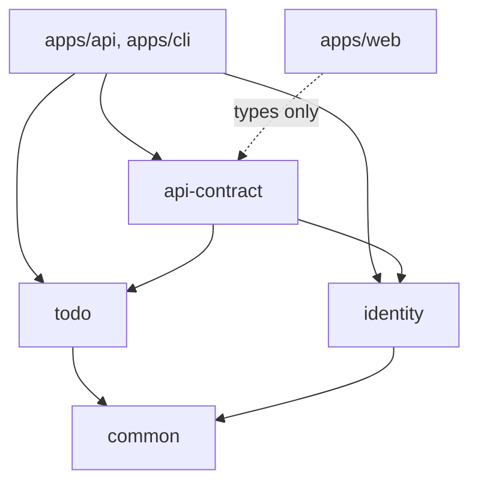

# hexstack

A TypeScript modular monolith template for applications with real business rules: Domain-Driven Design,
hexagonal architecture (ports and adapters), CQRS, a transactional outbox, cookie sessions with RBAC, Redis caching,
and local or S3-compatible object storage.

The repository is organized as one package per bounded context, each split into `domain`, `app`, `adapters`, `ports` and `service`, plus a `common`
package for shared infrastructure. It ships two contexts: **todo**, a small worked example, and **identity**
(accounts, sessions, roles), which most applications reuse as is.

## Contents

- [Requirements](#requirements)
- [Quick start](#quick-start)
- [Commands](#commands)
- [Repository layout](#repository-layout)
- [Architecture at a glance](#architecture-at-a-glance)
- [Documentation](#documentation)

## Requirements

| Tool   | Version                                               |
| ------ | ----------------------------------------------------- |
| Node   | ≥ 24.7 (`node:crypto.argon2`)                         |
| pnpm   | 12 (pinned in [mise.toml](mise.toml))                 |
| Docker | Any recent version, for local Postgres, Redis, MinIO |

## Quick start

```sh
pnpm install
cp .env.example .env   # first setup only
pnpm dev
```

`pnpm dev` starts Postgres (host port 6889) and Redis (6888), waits up to 120 s for their health checks, applies
pending migrations, then runs the API and the web app. If infrastructure or migrations fail, neither server starts.

| Service | URL                                                                   |
| ------- | --------------------------------------------------------------------- |
| API     | http://localhost:3001 (`/health`, `/rpc/*`, REST example `GET /todos`) |
| Web     | http://localhost:3000                                                 |

New accounts are **members**. Promote the first administrator from an operator shell:

```sh
pnpm cli user role you@example.com admin
```

There are no seed accounts, first-user promotion or public admin bootstrap endpoints. `Ctrl+C` stops the servers;
`pnpm infra:down` stops the infrastructure.

## Commands

| Command                                       | Purpose                                                                           |
| --------------------------------------------- | --------------------------------------------------------------------------------- |
| `pnpm dev`                                    | Start infrastructure, migrate, run API and web                                    |
| `pnpm dev:api` / `pnpm dev:web`               | Run one app against infrastructure that is already running and migrated           |
| `pnpm build`                                  | Bundle API and CLI (tsup), build the web app (Next.js)                            |
| `pnpm test`                                   | Run Vitest; SQL tests use the real migrations on PGlite, no Docker needed         |
| `pnpm check-types`                            | Type-check every package and app                                                  |
| `pnpm lint` / `pnpm format:check`             | oxlint / oxfmt checks (`pnpm lint:fix`, `pnpm format` to fix)                     |
| `pnpm db:generate --name <change>`            | Generate a migration from the Drizzle schemas of all contexts                     |
| `pnpm db:migrate`                             | Apply pending migrations under a Postgres advisory lock                           |
| `pnpm db:studio`                              | Open Drizzle Studio against the configured database                               |
| `pnpm cli <command>`                          | Operator CLI: `db migrate`, `user role`, `storage put/get/head/delete/sign`       |
| `pnpm infra:up` / `pnpm infra:down`           | Start (and wait for) / stop local Postgres and Redis                              |
| `pnpm infra:storage`                          | Start MinIO and create a private bucket (API :9000, console :9001)                |
| `pnpm infra:otel`                             | Start a local OpenTelemetry backend (Grafana :3300, OTLP :4317/:4318)             |

## Repository layout

```text
apps/
  api/                 Hono server: middleware, composition (contexts.ts), migrations (drizzle/postgres)
  cli/                 Operator CLI (clipanion)
  web/                 Next.js App Router client
packages/
  common/              Shared kernel and infrastructure, one subpath per concern (@app/common/<concern>)
  identity/            Bounded context: users, sessions, roles and permissions
  todo/                Bounded context: the worked example
  api-contract/        The composed RPC router type and the typed client
  typescript-config/   Shared tsconfig presets
deployment/            Docker Compose for local infrastructure, container images
docs/                  Reference documentation
```

Every bounded context has the same layout:

```text
packages/<context>/src/
  domain/      Entities, value objects, specifications, domain events, domain errors
  app/         Commands, queries, event handlers, outbound ports (repositories, services), DTOs, mappers
  adapters/    Implementations of the outbound ports: SQL repositories, Drizzle schema, external clients
  ports/       Inbound adapters: RPC procedures, HTTP handlers, event subscriptions, jobs, public error projections
  service/     The context's BoundedContext: what it registers into a process
  index.ts     The package's public API
```

## Architecture at a glance



- Bounded contexts never import each other. What they share (the request principal, the authorization port, error
  and event plumbing) lives in `common`.
- Inside a context, `domain` depends on nothing but `common/ddd` and Zod; `app` depends on `domain` and on ports it
  declares; `adapters` and `ports` depend on `app`; `service` wires them together.
- `common` never imports a context. Contexts plug into a process through the
  [`BoundedContext`](packages/common/src/service/bounded-context.ts) interface, and the apps list the contexts they serve.

See [docs/architecture.md](docs/architecture.md) for the full description.

## Documentation

| Document                                             | Contents                                                                          |
| ---------------------------------------------------- | --------------------------------------------------------------------------------- |
| [Architecture](docs/architecture.md)                 | Packages, layers, dependency rules, composition root, design decisions           |
| [Bounded contexts](docs/bounded-contexts.md)         | Reference for `todo` and `identity`; how to add a context                         |
| [Use cases and events](docs/use-cases-and-events.md) | Commands, queries, transactions, concurrency, in-process and outbox delivery      |
| [Errors](docs/errors.md)                             | Error model, public projections, HTTP/RPC/BullMQ behavior                         |
| [Persistence](docs/persistence.md)                   | Drizzle schemas, Kysely repositories, specifications, migrations, poolers         |
| [API](docs/api.md)                                   | RPC and REST surface, authentication of requests, web client                      |
| [Authentication and authorization](docs/auth.md)     | Passwords, sessions, RBAC, rate limiting, deployment rules                        |
| [Infrastructure](docs/infrastructure.md)             | Cache, locks, object storage, queues and scheduling, observability                |
| [Configuration](docs/configuration.md)               | Environment variables; renaming the template for a new project                    |
| [Testing](docs/testing.md)                           | Test layers, test database, CI                                                    |
| [Deployment](deployment/README.md)                   | Container images, releases, runtime configuration                                 |

## License

[MIT](LICENSE)
