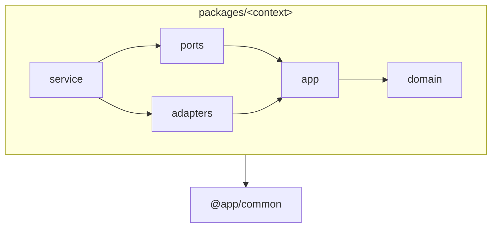

# Architecture

hexstack is a modular monolith. One deployable API (plus a CLI) serves several bounded contexts that share a
Postgres database and a Redis instance but not code. The package structure follows
[Wild Workouts](https://github.com/ThreeDotsLabs/wild-workouts-go-ddd-example): packages are cut by bounded context,
not by technical layer, and each context is layered internally.

- [Packages](#packages)
- [Layers inside a context](#layers-inside-a-context)
- [Dependency rules](#dependency-rules)
- [The common package](#the-common-package)
- [Composition root](#composition-root)
- [Request lifecycle](#request-lifecycle)
- [Design decisions](#design-decisions)

## Packages

| Package                                       | Role                                                                                   |
| --------------------------------------------- | -------------------------------------------------------------------------------------- |
| [`@app/common`](../packages/common)             | Shared kernel (DDD primitives, errors) and infrastructure (DB, Redis, queue, RPC, …)   |
| [`@app/identity`](../packages/identity)         | Bounded context: users, sessions, roles and permissions                                |
| [`@app/todo`](../packages/todo)                 | Bounded context: todos (the worked example)                                            |
| [`@app/api-contract`](../packages/api-contract) | The RPC router composed from every context's RPC port, its type, and the typed client  |
| [`apps/api`](../apps/api)                      | HTTP server process: middleware, process composition, scheduled maintenance            |
| [`apps/cli`](../apps/cli)                      | Operator process: migrations, role assignment, object storage commands                 |
| [`apps/web`](../apps/web)                      | Next.js client; imports router **types** from `@app/api-contract` only                |

Workspace packages export TypeScript source; there is no package build step. tsup bundles the API and the CLI,
and Next.js transpiles `@app/common` and `@app/api-contract` for the web app.

## Layers inside a context

| Directory   | Contains                                                                                                   | Must not contain                                     |
| ----------- | ---------------------------------------------------------------------------------------------------------- | ---------------------------------------------------- |
| `domain/`   | Entities, value objects, specifications, domain events, domain errors, pure policies                       | I/O, DI tokens, framework code                       |
| `app/`      | Command/query handlers, event handlers, service port interfaces and tokens, DTOs, mappers, `app.ts`        | Concrete clients (SQL, Redis, HTTP), transport types |
| `adapters/` | Repositories (interface, record, token and Kysely implementation), Drizzle schema, hashers, rate limiters | Business rules                                       |
| `ports/`    | Inbound adapters: oRPC procedures, Hono handlers, event subscriptions, scheduled jobs, public error maps   | Business rules, SQL                                  |
| `service/`  | The context's [`BoundedContext`](../packages/common/src/service/bounded-context.ts) object                  | Anything else                                        |

The naming follows Wild Workouts: **ports** are the ways into a context (what calls it), **adapters** are the ways
out (what it calls). Outbound port interfaces for services (`PasswordHasher`, `RateLimiter`) belong to `app/`, their
implementations to `adapters/`. A repository is the exception: its interface, record type, DI token and SQL
implementation share one file in `adapters/` (for example
[`adapters/todo.repository.ts`](../packages/todo/src/adapters/todo.repository.ts)), and handlers import the interface
and token from there.

`app/app.ts` lists every use case of the context as handler bindings
([todo](../packages/todo/src/app/app.ts), [identity](../packages/identity/src/app/app.ts)). Ports never call handlers
directly; they dispatch through the mediator, so validation, and therefore behavior, is the same for every entry point.

## Dependency rules



Arrows are imports, not call order.

1. **Contexts do not import each other.** Anything two contexts need to agree on is either in `common`
   (the request principal, the authorization port) or travels as data (event payloads, the principal's role string).
2. **`common` never imports a context.** Context-specific behavior reaches common code through the
   `BoundedContext` interface and DI tokens.
3. **`domain` imports only `@app/common/ddd`, `@app/common/zod`, millstream event definitions, and types from
   `@app/common/auth`.**
4. **`app` imports its own `domain`, common ports** (`@app/common/cqrs`, `events`, `cache`, `lock`, `queue`,
   `storage`, …) **and `di`/`logger`/`zod`**, never common adapters (`@app/common/db`, `cache/redis`, `queue/bullmq`, …).
   From its own `adapters/`, `app` imports only repository interfaces, record types and tokens; handlers depend on
   `ITodoRepository`, never on `TodoRepository`.
5. **Apps import contexts through their package root** (`@app/todo`, `@app/identity`); a context's `index.ts` is its
   public API. Adapters are not exported.

These rules are enforced by package boundaries and code review; there is no architecture linter.

## The common package

`@app/common` exposes one subpath per concern (`"./*": "./src/*/index.ts"`). Ports and adapters of the same concern
live in separate subpaths, so importing a port never loads its driver.

| Subpath                                                   | Contents                                                                          |
| --------------------------------------------------------- | --------------------------------------------------------------------------------- |
| `ddd`                                                     | `Entity`, `ValueObject`, specifications, state machine, ids, `DomainError`        |
| `errors`                                                  | Common errors, `PublicErrorMap`, `PublicErrorCatalog`, `HTTP_STATUS`              |
| `di`, `env`, `env/client`, `logger`, `zod`                | tsyringe, validated environment, pino logger, Zod                                 |
| `context`                                                 | Request-scoped `AsyncLocalStorage`: request id, client address, principal         |
| `auth`                                                    | `Permissions`, `AuthorizationPolicy` port, `currentPrincipal()`, `authorize()`    |
| `cqrs`                                                    | Mediator, `handle()`, `DomainEventTracker`, `ApplicationTransactionPort`          |
| `events`                                                  | Subscriptions, in-process event bus, outbox workers, pipeline port                |
| `events/millstream`                                       | Outbox relay (`MillstreamDomainEventPipeline`)                                    |
| `cache`, `cache/redis`, `cache/testing`                   | `CachePort`; Keyv/Redis adapter; in-memory test helper                            |
| `lock`, `lock/redis`                                      | `LockPort`; Redis (SET NX + Lua) adapter                                          |
| `queue`, `queue/bullmq`                                   | `JobDispatcher`; BullMQ adapter                                                   |
| `storage`, `storage/adapters`                             | `ObjectStoragePort` and storage errors; local and MinIO adapters                  |
| `redis`                                                   | Shared ioredis client                                                             |
| `db`, `db/schema`, `db/testing`                           | Kysely, transactions, outbox, migrator; table helpers for schemas; PGlite test DB |
| `rpc`                                                     | `rpcQuery` / `rpcMutation` procedure builders, RPC error mapping, `RpcServer`     |
| `service`                                                 | The `BoundedContext` interface                                                    |
| `bootstrap`                                               | `registerDI()` and its parts                                                      |

`db/schema` only depends on drizzle-orm so that drizzle-kit can load the schemas without the runtime.

## Composition root

A context describes what it contributes to a process:

```ts
export const todoContext: BoundedContext = {
  name: "todo",
  registerAdapters(container) {
    container.registerSingleton(TODO_REPO, TodoRepository);
  },
  handlers: TODO_HANDLERS, // app/app.ts
  subscriptions: TODO_SUBSCRIPTIONS, // ports/events.ts
  publicErrors: TODO_PUBLIC_ERRORS, // ports/public-errors.ts
};
```

| Member              | Registered by                 | Purpose                                                                  |
| ------------------- | ----------------------------- | ------------------------------------------------------------------------ |
| `registerAdapters`  | `registerDI` only             | Implementations of the context's outbound ports. Tests bind fakes instead |
| `registerServices`  | `registerApplication`         | Services other code needs whatever the adapters (identity: authorization) |
| `handlers`          | `registerApplication`         | Commands and queries bound to the mediator                               |
| `subscriptions`     | `registerApplication`         | In-process and outbox event handlers                                     |
| `publicErrors`      | `registerApplication`         | Public projections of the context's errors                               |

Each app lists the contexts it serves ([api](../apps/api/src/contexts.ts), [cli](../apps/cli/src/contexts.ts)) and
calls [`registerDI({ contexts })`](../packages/common/src/bootstrap/register.ts), which runs, in order:

1. `registerInfrastructure()`: request context, Postgres and transactions, outbox, Redis, cache and lock, object
   storage, outbox relay, BullMQ.
2. `registerAdapters()` of every context.
3. `registerApplication(contexts)`: merges the public error catalogs and the event subscriptions (duplicate names
   fail at startup), registers each context's services, builds the in-process event bus, and binds every handler to
   the mediator. Handlers are resolved immediately, so a missing dependency fails at startup, not on first use.
4. `registerJobs()`: one BullMQ worker per outbox subscription.

Tests that exercise the application layer register fakes for the outbound ports and call `registerApplication()` only
(see [app.test.ts](../apps/api/src/app.test.ts)).

The RPC router is composed separately, in [`@app/api-contract`](../packages/api-contract/src/router.ts), because the web
client needs its type. Adding a context therefore touches three places outside the context itself: `contexts.ts` in
each app and `router.ts` in the contract.

## Request lifecycle

An authenticated `todo.complete` call:

| Step | Code                                                                                         | Responsibility                                                        |
| ---- | -------------------------------------------------------------------------------------------- | --------------------------------------------------------------------- |
| 1    | [request-context.ts](../apps/api/src/middlewares/request-context.ts)                          | Request id, client address, `AsyncLocalStorage` scope                 |
| 2    | [csrf.ts](../apps/api/src/middlewares/csrf.ts)                                                | Rejects cross-site unsafe requests                                    |
| 3    | [identity ports/http.ts](../packages/identity/src/ports/http.ts)                              | Session cookie → principal (user id, session id, current role)        |
| 4    | [common rpc/procedure.ts](../packages/common/src/rpc/procedure.ts)                            | Requires a principal and the procedure's `permissions` meta           |
| 5    | [todo ports/rpc.ts](../packages/todo/src/ports/rpc.ts)                                        | Dispatches `CompleteTodoCommand` through the mediator                 |
| 6    | [complete-todo.command.ts](../packages/todo/src/app/command/complete-todo.command.ts)         | Loads the aggregate, applies the transition, persists in a transaction |
| 7    | [domain-event-tracker.ts](../packages/common/src/cqrs/domain-event-tracker.ts)                | Repository tracks the aggregate; outbox row before commit, broadcast after |
| 8    | [common rpc/errors.ts](../packages/common/src/rpc/errors.ts)                                  | Maps thrown domain errors through the public error catalog            |

Authorization is checked by the context-independent procedure builder through the
[`AuthorizationPolicy`](../packages/common/src/auth/authorization.ts) port, which the identity context implements
with its role table. The todo context names its own permissions (`{ todo: ["complete"] }`) without importing identity.

## Design decisions

| Decision                                                          | Consequence                                                                                                                              |
| ----------------------------------------------------------------- | ---------------------------------------------------------------------------------------------------------------------------------------- |
| One package per bounded context, layered inside                   | A feature lives in one package; cross-context imports are visible in `package.json`                                                     |
| One `common` package with subpath exports                         | One manifest holds every infrastructure dependency; subpaths keep ports from loading drivers                                            |
| Mediator and tsyringe DI                                          | Handlers are resolved by token; `app/app.ts` is the explicit use-case list, `service/` the explicit wiring                              |
| Each context types only its own tables                            | `getExecutor<TodoDatabase>()` cannot query another context's tables; one database and one migration history remain                     |
| The role table lives in identity, permission checks in common     | Contexts declare required permissions as data; a contract test checks every required permission exists in the identity catalog         |
| Public error projections are contributed per context              | Each context's map is exhaustive for its own error union at compile time; the catalog rejects duplicate tags at startup                 |
| Event subscriptions are contributed per context                   | Moving a handler between in-process and outbox delivery is a one-line change in the context's `ports/events.ts`                         |
| Repository/specification reads for queries                        | Queries share the command side's vocabulary; there is no separate read model                                                             |
| Repository interface and implementation in one file               | One place to read and change a repository; `app/` imports interfaces and tokens from `adapters/`, so the boundary is kept by convention (handlers inject the interface) rather than by file layout |
| Pure mapper functions in `app/`                                   | The stored record shape (`TodoRecord`) is visible to the application layer; the SQL row type is checked against it                      |
| Post-commit in-process events                                     | Best-effort handlers cannot roll back a committed write; required side effects use the outbox                                           |

Limits of the template: CQRS does not mean separate databases, domain events do not mean event sourcing, and
authorization at the RPC boundary does not protect direct mediator calls from new entry points (workers, CLI
commands, other transports must establish their own trust).
