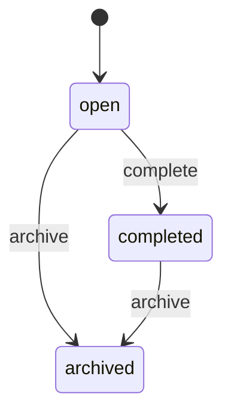

# Bounded contexts

- [todo](#todo)
- [identity](#identity)
- [Adding a bounded context](#adding-a-bounded-context)

## todo

Package: [`@app/todo`](../packages/todo). A shared todo list. It is the reference implementation of every mechanism
in the template; copy what a new context needs and delete the rest.

### Model

[`TodoEntity`](../packages/todo/src/domain/todo/todo.entity.ts) is the aggregate root. Its value objects are
[`TodoId`](../packages/todo/src/domain/todo/todo-id.value-object.ts),
[`TodoTitle`](../packages/todo/src/domain/todo/todo-title.value-object.ts) (1–200 characters, trimmed) and
[`TodoStatus`](../packages/todo/src/domain/todo/todo-status.value-object.ts), which owns the transitions:

There is no reopen. An illegal transition throws `TodoTransitionNotAllowedError` and leaves the entity unchanged.
Specifications: `TodoIdSpecification`, `TodoTitleSpecification`, `TodoStatusSpecification`
([specs/](../packages/todo/src/domain/todo/specs)).

### Use cases

| Definition            | Name            | Permission      | Handler                                                                           |
| --------------------- | --------------- | --------------- | --------------------------------------------------------------------------------- |
| `CreateTodoCommand`   | `todo.create`   | `todo:create`   | [create-todo.command.ts](../packages/todo/src/app/command/create-todo.command.ts)       |
| `CompleteTodoCommand` | `todo.complete` | `todo:complete` | [complete-todo.command.ts](../packages/todo/src/app/command/complete-todo.command.ts)   |
| `ArchiveTodoCommand`  | `todo.archive`  | `todo:archive`  | [archive-todo.command.ts](../packages/todo/src/app/command/archive-todo.command.ts)     |
| `ListTodosQuery`      | `todo.list`     | `todo:read`     | [list-todos.query.ts](../packages/todo/src/app/query/list-todos.query.ts)               |

All return [`ITodoDTO`](../packages/todo/src/app/todo.dto.ts) (`ListTodosQuery`: an array). `ListTodosQuery` reads
through the cache (`todos:list` namespace, 30 s ± 10 % TTL, single-flight loads).

### Events

| Event                | Wire name           | Subscriptions                                                                                       |
| -------------------- | ------------------- | --------------------------------------------------------------------------------------------------- |
| `TodoCreatedEvent`   | `todo.created.v1`   | in-process: `todo.created.log`, `todo.list-cache.todo.created.v1`                                    |
| `TodoCompletedEvent` | `todo.completed.v1` | in-process: `todo.completed.log`, `todo.list-cache.todo.completed.v1`; outbox: `todo.notify-completed` |
| `TodoArchivedEvent`  | `todo.archived.v1`  | in-process: `todo.archived.log`, `todo.list-cache.todo.archived.v1`                                  |

Declared in [ports/events.ts](../packages/todo/src/ports/events.ts). `todo.notify-completed` sets
`completion_notified_at` once, conditionally, and is the example of an idempotent outbox consumer.

### Ports and adapters

| Kind     | File                                                                     | Contents                                                |
| -------- | ------------------------------------------------------------------------ | ------------------------------------------------------- |
| Inbound  | [ports/rpc.ts](../packages/todo/src/ports/rpc.ts)                          | `todoRouter`: `create`, `complete`, `archive`, `list`  |
| Inbound  | [ports/http.ts](../packages/todo/src/ports/http.ts)                        | `listTodos`: the REST handler for `GET /todos`          |
| Inbound  | [ports/events.ts](../packages/todo/src/ports/events.ts)                    | `TODO_SUBSCRIPTIONS`                                    |
| Inbound  | [ports/public-errors.ts](../packages/todo/src/ports/public-errors.ts)      | `TODO_PUBLIC_ERRORS`                                    |
| Adapter  | [adapters/todo.repository.ts](../packages/todo/src/adapters/todo.repository.ts) | `ITodoRepository`, `TodoRecord`, `TODO_REPO` and the Kysely `TodoRepository` |
| Adapter  | [adapters/todo.schema.ts](../packages/todo/src/adapters/todo.schema.ts)    | Drizzle table `app_todo`                                |

## identity

Package: [`@app/identity`](../packages/identity). Accounts, password authentication, server-side sessions, and the
role-based access control used by every context. See [auth.md](auth.md) for the security properties.

### Model

| Aggregate                                                                         | Owns                                                       |
| --------------------------------------------------------------------------------- | ---------------------------------------------------------- |
| [`UserEntity`](../packages/identity/src/domain/user/user.entity.ts)                | Email, password hash, role; records sign-up and role changes |
| [`SessionEntity`](../packages/identity/src/domain/session/session.entity.ts)       | Expiry and sliding refresh; references the user by id      |

Value objects: `UserId`, `UserEmail` (trimmed, lowercased), `UserRole`, `Password` (new-password policy),
`PasswordHash` (opaque, redacted), `SessionId`. The RBAC catalog and role table are in
[domain/rbac/permissions.ts](../packages/identity/src/domain/rbac/permissions.ts).

### Use cases

| Definition            | Name                | Access           | Handler                                                                                        |
| --------------------- | ------------------- | ---------------- | ---------------------------------------------------------------------------------------------- |
| `SignUpCommand`       | `auth.sign-up`      | public           | [sign-up.command.ts](../packages/identity/src/app/command/sign-up.command.ts)                  |
| `SignInCommand`       | `auth.sign-in`      | public           | [sign-in.command.ts](../packages/identity/src/app/command/sign-in.command.ts)                  |
| `SignOutCommand`      | `auth.sign-out`     | signed in        | [sign-out.command.ts](../packages/identity/src/app/command/sign-out.command.ts)                |
| `SignOutAllCommand`   | `auth.sign-out-all` | signed in        | [sign-out.command.ts](../packages/identity/src/app/command/sign-out.command.ts)                |
| `GetCurrentUserQuery` | `auth.current-user` | public (`me`)    | [get-current-user.query.ts](../packages/identity/src/app/query/get-current-user.query.ts)      |
| `ListUsersQuery`      | `user.list`         | `user:list`      | [list-users.query.ts](../packages/identity/src/app/query/list-users.query.ts)                  |
| `AssignRoleCommand`   | `user.assign-role`  | `user:assignRole` | [assign-role.command.ts](../packages/identity/src/app/command/assign-role.command.ts)         |

[`SessionService`](../packages/identity/src/app/session.service.ts) creates, validates, refreshes and deletes sessions;
the HTTP authentication middleware and the session cleanup job use it directly.

### Events

| Event                  | Wire name              | Subscriptions                         |
| ---------------------- | ---------------------- | ------------------------------------- |
| `UserSignedUpEvent`    | `user.signed-up.v1`    | none                                  |
| `UserRoleChangedEvent` | `user.role-changed.v1` | in-process: `user.role-changed.log`   |

### Ports and adapters

| Kind     | File                                                                                     | Contents                                                     |
| -------- | ---------------------------------------------------------------------------------------- | ------------------------------------------------------------ |
| Inbound  | [ports/auth.rpc.ts](../packages/identity/src/ports/auth.rpc.ts)                            | `authRouter`: `signUp`, `signIn`, `signOut`, `signOutAll`, `me` |
| Inbound  | [ports/user.rpc.ts](../packages/identity/src/ports/user.rpc.ts)                            | `userRouter`: `list`, `assignRole`                           |
| Inbound  | [ports/http.ts](../packages/identity/src/ports/http.ts)                                    | `authenticate()`: Hono middleware, cookie → principal        |
| Inbound  | [ports/session-cookie.ts](../packages/identity/src/ports/session-cookie.ts)                | Cookie name, parsing and serialization                       |
| Inbound  | [ports/jobs.ts](../packages/identity/src/ports/jobs.ts)                                    | `scheduleSessionCleanup()`: hourly BullMQ repeatable job     |
| Inbound  | [ports/events.ts](../packages/identity/src/ports/events.ts)                                | `IDENTITY_SUBSCRIPTIONS`                                     |
| Inbound  | [ports/public-errors.ts](../packages/identity/src/ports/public-errors.ts)                  | `IDENTITY_PUBLIC_ERRORS`                                     |
| Outbound | `app/password-hasher.port.ts`, `app/rate-limiter.port.ts`                                  | `PasswordHasher`, `RateLimiter`                              |
| Adapter  | [adapters/user.repository.ts](../packages/identity/src/adapters/user.repository.ts), [session.repository.ts](../packages/identity/src/adapters/session.repository.ts) | `IUserRepository` / `ISessionRepository`, records, tokens and Kysely implementations |
| Adapter  | [adapters/](../packages/identity/src/adapters)                                             | Argon2id hasher, Redis token bucket                          |
| Adapter  | [adapters/identity.schema.ts](../packages/identity/src/adapters/identity.schema.ts)        | Drizzle tables `app_user`, `app_session`                     |
| Service  | [adapters/role-authorization-policy.ts](../packages/identity/src/adapters/role-authorization-policy.ts) | `AuthorizationPolicy` for `@app/common/auth` |

## Adding a bounded context

The steps below add an `invoice` context. Copy from `packages/todo` and delete what the context does not need
(outbox subscriptions, caching, the REST handler).

1. **Package.** Create `packages/invoice` with the same `package.json`, `tsconfig.json` and `vitest.config.ts` as
   `packages/todo`, renamed to `@app/invoice`. Run `pnpm install`.
2. **Domain** (`src/domain/invoice/`). Entities, value objects, specifications, errors (`invoice.errors.ts`) and
   events. Event names are wire contracts: `defineEvent("invoice.<fact>.v1", schema)`.
3. **Application** (`src/app/`). DTO, mapper, one file per command/query under `command/` and `query/`, event
   handlers under `event/`. List the handlers in `app/app.ts` with `handle()`.
4. **Adapters** (`src/adapters/`).
   - `invoice.schema.ts`: the Drizzle table, built with `pgTable` and `timestamp` from `@app/common/db/schema`.
   - `invoice.database.ts`: `type InvoiceDatabase = KyselyTables<{ invoice: typeof invoice }>` and the table name.
   - `invoice.repository.ts`: the `IInvoiceRepository` interface, `InvoiceRecord`, the `INVOICE_REPO` token and the
     implementation, querying through `transactions.getExecutor<InvoiceDatabase>()`.
   - A `QueryVisitor` subclass for its specifications.
5. **Ports** (`src/ports/`). `rpc.ts` with procedures built from `rpcQuery` / `rpcMutation` and
   `.meta({ permissions: { invoice: ["read"] } })`; `events.ts` with the subscriptions; `public-errors.ts` with a
   `PublicErrorMap` that `satisfies` the context's error union.
6. **Service** (`src/service/invoice.context.ts`). Export a `BoundedContext` with `registerAdapters`, `handlers`,
   `subscriptions` and `publicErrors`. Export it, the router and the types other packages need from `src/index.ts`.
7. **Permissions.** Add the `invoice` resource to `statements` and grant it in `rolePermissions` in
   [identity's permissions.ts](../packages/identity/src/domain/rbac/permissions.ts). The contract test fails if a
   procedure requires a permission that is not declared there.
8. **Composition.** Add `invoiceContext` to [apps/api/src/contexts.ts](../apps/api/src/contexts.ts) and
   [apps/cli/src/contexts.ts](../apps/cli/src/contexts.ts), the router to
   [api-contract/src/router.ts](../packages/api-contract/src/router.ts), and `@app/invoice` to the dependencies of
   `apps/api`, `apps/cli` and `packages/api-contract`.
9. **Migration.** `pnpm db:generate --name add_invoice`; drizzle-kit picks up every `packages/*/src/adapters/*.schema.ts`.
10. **Client.** The web app gets `orpc.invoice.*` from the router type; no code generation.

New procedures require a signed-in caller unless marked `public: true`.
