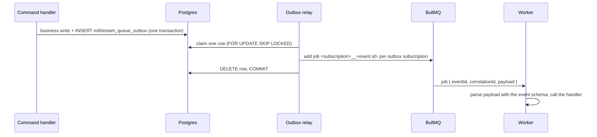

# Use cases and events

- [Commands and queries](#commands-and-queries)
- [Writing a command handler](#writing-a-command-handler)
- [Transactions](#transactions)
- [Concurrency](#concurrency)
- [Domain events](#domain-events)
- [Subscriptions](#subscriptions)
- [Outbox delivery](#outbox-delivery)
- [Guarantees and limits](#guarantees-and-limits)

## Commands and queries

Use cases are [millstream](https://github.com/kouovo/millstream) request definitions: a name, a Zod schema and a
result type. The definition is also the payload type its handler receives.

```ts
export const CreateTodoCommand = defineCommand("todo.create", createTodoCommand).returns<ITodoDTO>();
export const ListTodosQuery = defineQuery("todo.list", listTodosQuery).returns<ITodoDTO[]>();
```

| Rule                                                                                                              |
| ----------------------------------------------------------------------------------------------------------------- |
| A command changes state; a query does not perform business writes                                                 |
| Commands may return a DTO                                                                                         |
| Handlers implement `IRequestHandler<typeof Definition>` and are `@singleton()` DI classes                         |
| Every handler of a context is listed in its `app/app.ts` with `handle(Definition, Handler)`                       |
| Ports call `mediator.execute(Command, input)` / `mediator.query(Query, input)`, never a handler directly          |
| The mediator validates the input against the schema (applying defaults) before the handler runs                   |

The mediator is in-process dispatch (DI token `MEDIATOR`), not a message bus. millstream's `InvalidRequestError` and
`HandlerNotFoundError` are not domain errors and surface as 500; transports validate input before dispatching.

## Writing a command handler

A write handler converts input to domain types, loads the aggregate through a repository interface, calls a domain method,
persists, and returns an explicit DTO. The entity decides whether a transition is allowed; the handler decides what is
persisted together.

```ts
const changed = await this.events.run(async (track) => {
  const todo = await this.todoRepo.findOne(new TodoIdSpecification(id));
  if (!todo) throw new TodoNotFoundError({ todoId: id.value });
  const expectedStatus = todo.status.value;
  todo.complete();
  if (!(await this.todoRepo.updateIfStatus(todo, expectedStatus))) {
    throw new TodoModifiedConcurrentlyError({ todoId: id.value, expectedStatus });
  }
  track(todo);
  return todo;
});
return toTodoDTO(changed);
```

Reference: [complete-todo.command.ts](../packages/todo/src/app/command/complete-todo.command.ts). Work that must not run
inside the transaction goes before `run` (for example, [sign-up](../packages/identity/src/app/command/sign-up.command.ts)
hashes the password first, then inserts the user and the first session atomically).

## Transactions

[`DomainEventScope.run(work, options?)`](../packages/common/src/cqrs/domain-event-scope.ts):

1. Opens an application transaction through `ApplicationTransactionPort`.
2. Runs `work(track)`. `track(aggregate)` registers aggregates whose recorded events must be published.
3. After `work` returns, collects the tracked aggregates' events and writes those that have an outbox subscription
   to the outbox, in the same transaction.
4. Commits, then publishes every collected event on the in-process bus.

| Property         | Behavior                                                                                                         |
| ---------------- | ---------------------------------------------------------------------------------------------------------------- |
| Rollback         | Any throw rolls back the writes and the outbox rows; nothing is published                                       |
| Nesting          | A nested `run` joins the outer one; events go out once, after the outermost commit                               |
| Savepoints       | None: an outer scope that catches an inner throw still commits the inner writes                                 |
| Broadcast errors | Logged; the committed write stands                                                                               |
| Options          | `isolationLevel` (default `read committed`), `statementTimeoutMs`, `heavy` (uses `DB_HEAVY_STATEMENT_TIMEOUT_MS`) |

Repositories and the outbox obtain their executor from the ambient
[`TransactionManager`](../packages/common/src/db/transaction.ts), so they cannot commit independently. Do not open a
`DomainEventScope` inside a bare `ApplicationTransactionPort.run`: it would broadcast before that outer commit.

## Concurrency

Domain guards are checked against the state that was read. Two requests can read the same `open` todo, so the
todo repository writes with a conditional update ([`updateIfStatus`](../packages/todo/src/adapters/todo.repository.ts)):
the row changes only if its status is still the one that was read. The losing request throws
`TodoModifiedConcurrentlyError` (409) and rolls back. Concurrent sign-ups with the same email are rejected by the
unique index (`EmailAlreadyRegisteredError`, 409). There is no generic version column.

## Domain events

Events are millstream definitions with a versioned wire name:

```ts
export const TodoCompletedEvent = defineEvent(
  "todo.completed.v1",
  z.object({ todoId: z.string(), completedAt: z.coerce.date<Date>() }),
);
```

- The wire name is the topic, the outbox row's destination and part of every BullMQ job id. Never rename it; publish a
  new version instead.
- Entities record events with `this.addDomainEvent(Event, payload)`. The event id (message uuid) is fixed at that
  moment and is the same on every transport.
- Payloads are validated when published and again when consumed. They cross every boundary as JSON; the schema
  restores types (`z.coerce.date()` restores `Date`).
- Domain events are internal. Publish a dedicated integration event through a durable adapter if another system must
  consume a fact.

## Subscriptions

Each context declares its subscriptions in `ports/events.ts`:

```ts
export const TODO_SUBSCRIPTIONS = {
  inProcess: [subscribe(TodoCreatedEvent, "todo.created.log", TodoCreatedLogEventHandler) /* … */],
  outbox: [subscribe(TodoCompletedEvent, "todo.notify-completed", NotifyTodoCompletedEventHandler)],
} satisfies EventSubscriptions;
```

A handler implements [`EventHandler<Payload>`](../packages/common/src/events/subscription.ts):
`handle(event, meta)`, where `meta.id` is the event id. `registerApplication` merges the subscriptions of all
contexts; a duplicate name fails at startup.

|            | `inProcess`                                                                              | `outbox`                                                                                    |
| ---------- | ---------------------------------------------------------------------------------------- | ------------------------------------------------------------------------------------------- |
| When       | After commit, in the committing process                                                  | After commit, in a BullMQ worker on any replica                                             |
| How        | [In-process bus](../packages/common/src/events/in-process-event-bus.ts): `MemoryPubSub`, all handlers in parallel | Outbox row → relay → one BullMQ job per subscription → [worker](../packages/common/src/events/outbox-workers.ts) |
| Guarantee  | Best effort: a failure is logged and dropped; process death loses it                     | At least once: handlers must be idempotent; BullMQ owns attempts, backoff, failed jobs      |
| Context    | No request context, no transaction                                                       | No request context, no transaction                                                          |
| Use for    | Logging, cache invalidation, broadcasts                                                  | Side effects that must happen                                                               |

Moving a handler from one list to the other changes its delivery. Fan-out is one `subscribe` per handler. Only events
that have at least one outbox subscription are written to the outbox; every event is published in process.

## Outbox delivery



| Component                                                                                        | Behavior                                                                                                               |
| ------------------------------------------------------------------------------------------------ | ---------------------------------------------------------------------------------------------------------------------- |
| [Outbox writer](../packages/common/src/db/domain-event-outbox.ts)                                 | millstream `EventBus` over a forwarder publisher; writes envelopes to `millstream_queue_outbox` in the ambient transaction |
| [Relay](../packages/common/src/events/millstream/domain-event-pipeline.ts)                        | Runs in every API replica; polls every `OUTBOX_POLL_INTERVAL_MS`; started and stopped by [apps/api/src/index.ts](../apps/api/src/index.ts) |
| Jobs                                                                                             | Queue = subscription name; job id `<name>__<event id>`; `DOMAIN_EVENT_JOB_ATTEMPTS` with exponential `DOMAIN_EVENT_JOB_BACKOFF_MS` |
| [Workers](../packages/common/src/events/outbox-workers.ts)                                         | One per outbox subscription, registered by `registerJobs()`                                                           |
| Unknown events                                                                                   | A row whose event has no outbox subscription in this process (rolling deploy) stays in the outbox and is retried        |
| Redis down                                                                                       | The relay's producer has no offline queue: the enqueue fails, the row stays, and the relay retries after 1 s          |
| Failures                                                                                         | A non-retryable `DomainError` fails the job permanently; other errors retry; exhausted jobs stay in the failed set   |

Rows exist only until BullMQ accepts the jobs; there is no cleanup job. Renaming an outbox subscription starts a new,
empty queue: drain the old one first.

## Guarantees and limits

- Delivery is at least once. A crash after the BullMQ add but before the outbox commit relays the event again; BullMQ
  deduplicates by job id only while the job is retained (1,000 completed, 5,000 failed).
- There is no ordering guarantee across replicas or retries.
- After relay, jobs live only in Redis. Run Redis with persistence and `maxmemory-policy noeviction`.
- The outbox closes the gap between a commit and a publish; it is not exactly-once. The example consumer is effectively
  once because its write is conditional. External effects (mail, payments) need their own idempotency key; use `meta.id`.
